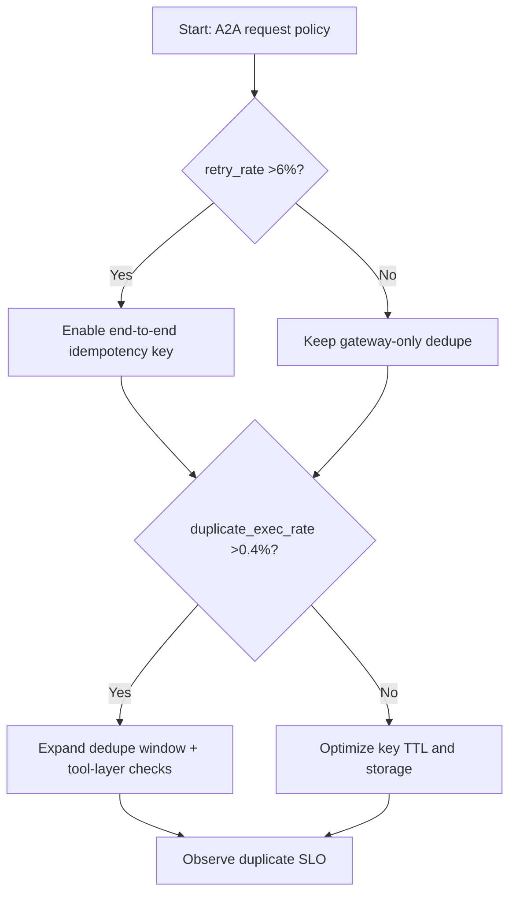
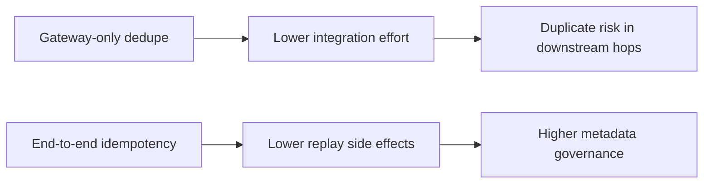
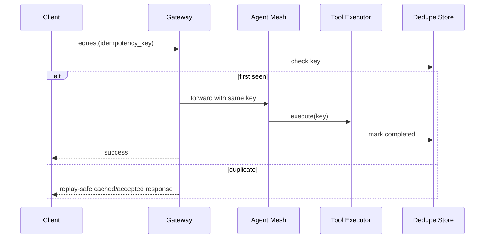

# Agent A2A Idempotency Key Replay Protection Selection FAQ (Azure AI Agent Infra)

## 1) 3-minute conclusions
- **If A2A retry rate exceeds 6% and duplicate execution exceeds 0.4%, enforce end-to-end idempotency keys with dedupe windows.**
- **Gateway-only dedupe is insufficient; key propagation and verification must continue across agent hops and tool execution layers.**
- **Targets: duplicate execution <0.1%, idempotency-check latency P95 <35ms, dedupe window >=2× longest retry period.**

## 2) Q1 / Q2 / Q3
- **Why duplicates happen?** Timeout retries, parallel replay, and network jitter submit the same intent multiple times.
- **Why end-to-end propagation?** Losing keys mid-path prevents downstream dedupe.
- **Minimum viable loop?** Key format policy, dedupe storage, conflict response semantics, TTL cleanup.

### Q1: When must dedupe windows be extended?
When cross-region retry periods exceed 90s or async callback chains can delay by minutes.

### Q2: When is a short window acceptable?
Single-region low-latency paths without async fan-out callbacks.

### Q3: How to quantify benefit?
Compare duplicate-execution reduction against incremental dedupe store/query cost.

## 3) Mermaid diagrams
### 3.1 Decision tree

### 3.2 Path comparison

### 3.3 Sequence

## 4) Decision matrix
| Dimension | Gateway-only dedupe | End-to-end idempotency (Recommended) |
|---|---:|---:|
| Duplicate execution | 0.3%–1.2% | 0.02%–0.12% |
| Retry safety | Medium | High |
| Implementation complexity (1-10) | 4 | 8 |
| Cross-layer observability | Low | High |
| Business side-effect risk | Medium-high | Low |

## 5) Quant model + 7-card insights
- Duplicate risk: `DupRisk = DuplicateExec / TotalExec`
- Dedupe cost: `DedupeCost = KeyOps * UnitCost`
- Example (`synthetic_assumed`):
  - `DuplicateExec=84, TotalExec=92,000`
  - `DupRisk=0.091%`
  - `KeyOps=2.4M/day, UnitCost=$0.0000007`
  - `DedupeCost=$1.68/day`
- Evidence:
  - `workshops/azure-agent-infra/evidence/cycle-1462-benchmark.json`
  - `workshops/azure-agent-infra/evidence/cycle-1462-sources.json`
- Labels: `official/synthetic_assumed/not_measured`.

## 6) Production verification checklist
- [ ] Idempotency key is propagated across gateway, A2A, and tool layers
- [ ] Dedupe store supports TTL, concurrent-write protection, and replay semantics
- [ ] Duplicate-exec and retry-latency alert thresholds are active
- [ ] Async callback chains pass idempotency drills
- [ ] FAQ/7-card source labels are complete
