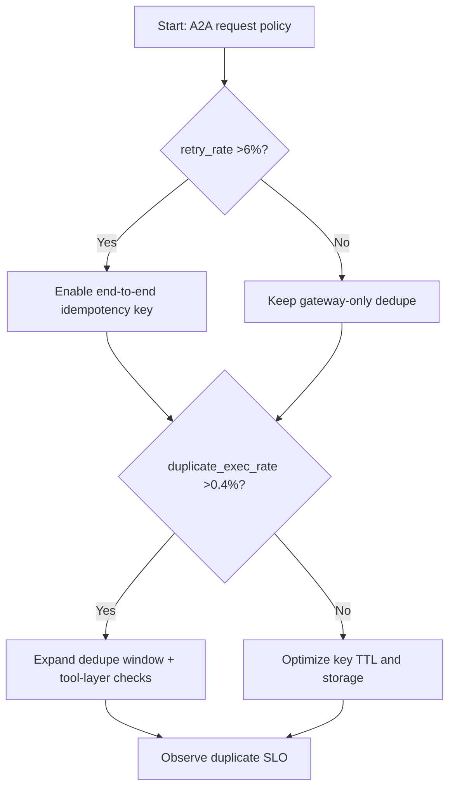
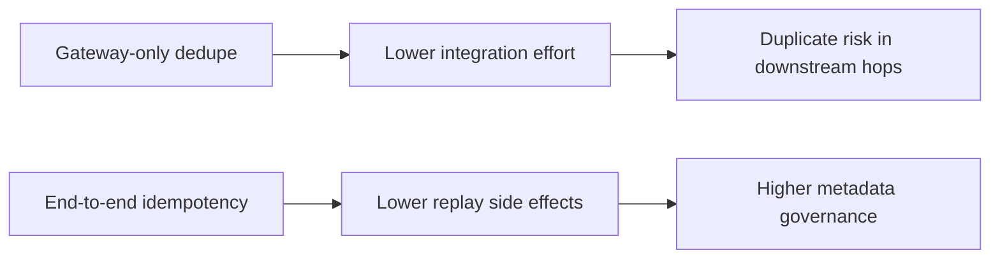
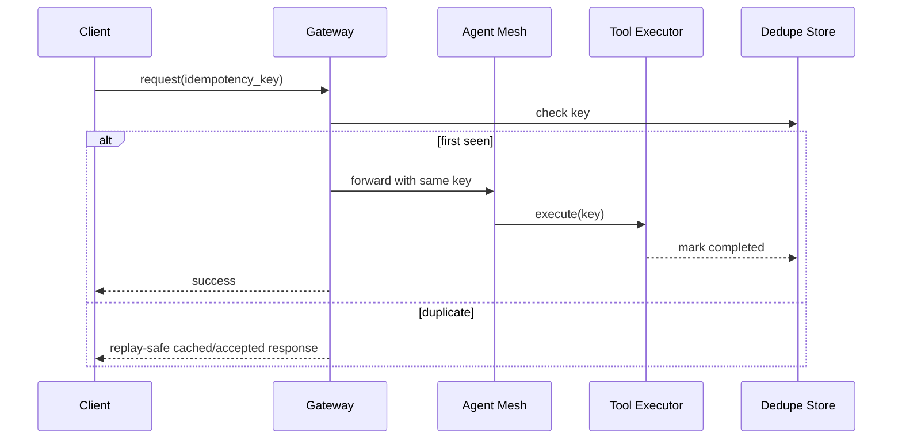

# Agent A2A Idempotency Key Replay Protection 选型 FAQ（Azure AI Agent Infra）

## 1) 3 分钟结论
- **当 A2A 链路重试率 >6% 且重复执行率 >0.4% 时，必须启用全链路幂等键（idempotency key）和去重窗口。**
- **仅在入口网关做去重不够，代理间转发、工具调用层也要传递并校验同一幂等键。**
- **生产阈值：重复执行率 <0.1%、幂等校验延迟 P95 <35ms、去重窗口 >=2×最长重试周期。**

## 2) Q1 / Q2 / Q3
- **为什么会重复执行？**：超时重试、并行回放、网络抖动导致同一意图被多次提交。
- **为什么要全链路传递？**：中间层丢失键会让后端无法识别重复请求。
- **最小闭环？**：键生成规范、去重存储、冲突返回语义、过期清理。

### Q1：什么时候必须延长去重窗口？
当跨区重试最长周期 >90 秒或异步回调链路存在分钟级延迟。

### Q2：什么时候可以短窗口？
单区低延迟场景且无异步回调分叉。

### Q3：如何量化收益？
比较重复执行下降比例与去重存储/查询成本增量。

## 3) Mermaid 图
### 3.1 决策树

### 3.2 路径对比

### 3.3 时序

## 4) 决策矩阵
| 维度 | 仅网关去重 | 全链路幂等键（推荐） |
|---|---:|---:|
| 重复执行率 | 0.3%–1.2% | 0.02%–0.12% |
| 重试安全性 | 中 | 高 |
| 实施复杂度（1-10） | 4 | 8 |
| 跨层可观测性 | 低 | 高 |
| 业务副作用风险 | 中高 | 低 |

## 5) 定量算例与 7-Card 洞察
- 重复风险：`DupRisk = DuplicateExec / TotalExec`
- 去重成本：`DedupeCost = KeyOps * UnitCost`
- 示例（`synthetic_assumed`）：
  - `DuplicateExec=84, TotalExec=92,000`
  - `DupRisk=0.091%`
  - `KeyOps=2.4M/day, UnitCost=$0.0000007`
  - `DedupeCost=$1.68/day`
- 证据：
  - `workshops/azure-agent-infra/evidence/cycle-1462-benchmark.json`
  - `workshops/azure-agent-infra/evidence/cycle-1462-sources.json`
- 标签：`official/synthetic_assumed/not_measured`。

## 6) 生产核验 Checklist
- [ ] 幂等键在网关、A2A、工具层全链路透传
- [ ] 去重存储支持 TTL、并发写冲突保护、回放语义
- [ ] 重复执行与重试延迟告警阈值已生效
- [ ] 异步回调链路幂等校验通过演练
- [ ] FAQ/7-Card 来源标签完整
