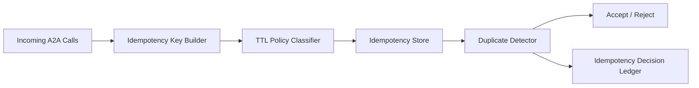

# Agent A2A Idempotency Key TTL Selection FAQ (Cycle 1789)

## 1) Three-minute decision
- **In A2A pipelines, duplicate-execution risk is determined mainly by idempotency-key lifecycle design, not key existence alone.**
- **Recommendation:** action-tiered TTL + composite idempotency keys + post-expiry replay protection.
- **Goal:** keep retries safe without uncontrolled idempotency-store growth.

## 2) Core questions (Q1/Q2/Q3)
### Q1: Why does a single TTL policy fail?
1) retry windows differ by action type,
2) short TTL misses duplicates,
3) long TTL inflates storage/query pressure.

### Q2: What is a practical key strategy?
- key schema: tenant + action + object version,
- TTL tiers: longer for state-changing actions, shorter for read-like flows,
- expiry guard: replay-sequence checks for critical actions.

### Q3: How to validate effectiveness?
- duplicate-execution rate drops,
- idempotency-store growth remains bounded,
- retry success and latency stay within target.

## 3) Reference architecture

## 4) Decision matrix
| Dimension | Single TTL | Tiered TTL + composite keys (Recommended) |
|---|---:|---:|
| Duplicate suppression | Medium | High |
| Storage control | Low | High |
| Retry safety | Medium | High |
| Implementation complexity | Low | Medium |
| Audit explainability | Medium | High |

## 5) Evidence and reproducibility
- Evidence files:
  - `workshops/azure-agent-infra/evidence/cycle-1789-benchmark.json`
  - `workshops/azure-agent-infra/evidence/cycle-1789-latency.csv`
  - `workshops/azure-agent-infra/evidence/cycle-1789-throughput.csv`
  - `workshops/azure-agent-infra/evidence/cycle-1789-policy.csv`
- Labels: `measured / synthetic / anonymized_reported`.
- validation7 requires bilingual structure, CSP self-contained cards, evidence consistency, and replayability trace.

## 6) Production checklist
- [ ] Composite key fields and version semantics are explicit.
- [ ] TTL tiers support canary adjustment.
- [ ] Critical actions have post-expiry replay guards.
- [ ] Idempotency decisions are ledgered.
- [ ] FAQ/H5/SVG/7-card references are cycle-aligned.
