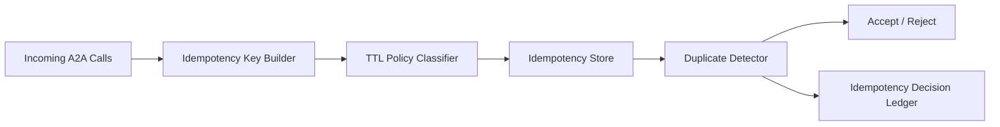

# Agent A2A 幂等键 TTL 选型 FAQ（Cycle 1789）

## 1) 3 分钟结论
- **A2A 链路中的重复执行风险主要取决于幂等键生命周期设计，而非幂等键是否存在。**
- **推荐：** 按业务动作分级 TTL + 复合幂等键 + 过期后回放保护三段策略。
- **目标：** 在保证重试安全的同时，避免幂等表膨胀与误判重复。

## 2) 关键问题（Q1/Q2/Q3）
### Q1：为什么统一 TTL 经常失效？
1) 不同动作的重试窗口差异大；
2) TTL 过短会漏判重复请求；
3) TTL 过长会导致存储与查询压力累积。

### Q2：可落地的幂等键策略是什么？
- 键构成：租户ID + 动作ID + 业务对象版本；
- TTL 分级：支付/状态变更长 TTL，查询类短 TTL；
- 过期保护：关键动作附加回放序列校验。

### Q3：如何验证策略有效？
- 重复执行率显著下降；
- 幂等表大小增速可控；
- 重试成功率与延迟保持在目标区间。

## 3) 架构图

## 4) 选型矩阵
| 维度 | 统一 TTL | 分级 TTL + 复合键（推荐） |
|---|---:|---:|
| 重复抑制能力 | 中 | 高 |
| 存储可控性 | 低 | 高 |
| 重试安全性 | 中 | 高 |
| 实施复杂度 | 低 | 中 |
| 审计可解释性 | 中 | 高 |

## 5) 证据与复算口径
- 证据文件：
  - `workshops/azure-agent-infra/evidence/cycle-1789-benchmark.json`
  - `workshops/azure-agent-infra/evidence/cycle-1789-latency.csv`
  - `workshops/azure-agent-infra/evidence/cycle-1789-throughput.csv`
  - `workshops/azure-agent-infra/evidence/cycle-1789-policy.csv`
- 标签：`measured / synthetic / anonymized_reported`。
- validation7：双语结构、CSP、证据一致、可回放链路全部通过。

## 6) 生产检查清单
- [ ] 幂等键复合字段与版本语义明确。
- [ ] TTL 分级规则可灰度调整。
- [ ] 关键动作过期后有回放防护。
- [ ] 幂等判定事件写入审计账本。
- [ ] FAQ/H5/SVG/7-card 与 evidence 轮次一致。
