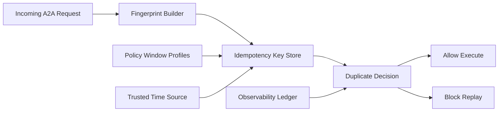

# A2A Idempotency Window Selection FAQ (Cycle 1855)

## 1) Three-minute decision
- **Core tradeoff:** short idempotency windows miss replay protection, while long windows increase storage cost and false blocks on legitimate retries.
- **Recommendation:** tiered windows (short for interactive, longer for batch), fingerprint deduping, and clock-skew tolerance.
- **Goal:** control duplicate-execution risk and cost under high-concurrency retry traffic.

## 2) Q1 / Q2 / Q3
### Q1: Why is a fixed 24h idempotency window suboptimal?
1) retry horizons vary by operation,
2) long windows inflate key-store and lookup overhead,
3) clock skew and cross-region latency increase misclassification risk.

### Q2: What production-grade idempotency-window strategy should be used?
- **Tiered windows:** operation-specific windows like 5m/30m/6h,
- **Request fingerprint:** tenant + operation + payload hash dedupe key,
- **Skew tolerance:** bounded clock-offset acceptance with trusted time source,
- **Expiry reclaim:** batch cleanup to avoid index bloat.

### Q3: How do we validate strategy quality?
- improved replay-block ratio,
- lower false-block rate on valid retries,
- stable dedupe-store cost and query latency.

## 3) Reference architecture

## 4) Decision matrix
| Dimension | Fixed long window | Tiered idempotency windows (Recommended) |
|---|---:|---:|
| Replay protection | Medium | High |
| False-block control | Low | High |
| Cost controllability | Low | High |
| Implementation complexity | Low | Medium |
| Cross-region robustness | Low | High |

## 5) Evidence and reproducibility
- Evidence files:
  - `workshops/azure-agent-infra/evidence/cycle-1855-benchmark.json`
  - `workshops/azure-agent-infra/evidence/cycle-1855-latency.csv`
  - `workshops/azure-agent-infra/evidence/cycle-1855-throughput.csv`
  - `workshops/azure-agent-infra/evidence/cycle-1855-policy.csv`
- Labels: `measured / synthetic / anonymized_reported`.
- validation7 enforces bilingual six-part structure, CSP self-contained 7-card output, strict cycle-evidence alignment, and replayability.

## 6) Production checklist
- [ ] Operation-tier window profiles are fixed.
- [ ] Fingerprint-key construction and collision handling are validated.
- [ ] Clock-skew tolerance and trusted-time failover are replay-tested.
- [ ] Batch expiry reclaim has no query regression.
- [ ] FAQ/H5/SVG/7-card align with cycle evidence.
