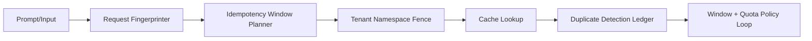

# Agent A2A Idempotency Window Governance Selection FAQ (Narrow Static Window vs Adaptive Tiered Window)

## 1) Core conclusions
- **Production multi-tenant gateways should default to adaptive tiered idempotency windows with policy versioning**, not raw prompt hash only.
- **Narrow static idempotency windows destabilize dedupe effectiveness under retry storms**, amplifying fallback calls and tail latency.
- **Idempotency-window governance must be coupled with tenant namespaces, dedupe controls, and window/quota policy loops** for durable gains.

## 2) Q1 / Q2 / Q3 (plain terms first)
- **Narrow static idempotency window**: hash input text directly; simple but highly sensitive to minor textual variance.
- **Adaptive tiered idempotency window**: canonicalize inputs (template + slots + policy version) before key generation.

### Q1: Why are raw hash keys unstable in production?
First principle: different workload heat curves require different expiry windows; one narrow static window allows duplicate escapes or over-blocking.

### Q2: When is a narrow static idempotency window still acceptable?
Short-lived single-tenant flows with rigid prompt templates, lower hit-rate expectations, and tolerance for occasional fallback spikes.

### Q3: What is the minimum safe idempotency-window control loop?
Request fingerprinting -> idempotency key registry -> tenant namespace isolation -> duplicate-detection ledger -> window/quota tuning -> replay audit.

## 3) Mermaid (A2A idempotency-window governance loop)

## 4) Decision matrix
| Dimension | Narrow static idempotency window | Adaptive tiered idempotency window |
|---|---|---|
| Implementation complexity | Low | Medium-High |
| Hit-rate stability | Low-Medium | High |
| Fallback amplification control | Low | High |
| Multi-tenant isolation governance | Medium | High |
| Default production fit | Short transitional phase | Multi-tenant long-running workloads |

## 5) Evidence contract + recomputable examples (n/denominator/source)
> Percentages in this section are `synthetic_assumed` hypothetical examples for mechanism comparison; production mechanism validation remains `not_measured`.  
> Contract fields: `workshops/azure-agent-infra/evidence/cycle-428-benchmark.json` -> `percentage_contract`.

- Metric A (duplicate-escape rate, narrow static window)  
  - Formula: `n_duplicate_escape_narrow / n_sessions_observed`  
  - Value: `256/2000 = 12.8%` (`synthetic_assumed`)  
  - Path: `percentage_contract.narrow_window_duplicate_escape_rate`
- Metric B (duplicate-escape rate, adaptive tiered window)  
  - Formula: `n_duplicate_escape_adaptive / n_sessions_observed`  
  - Value: `62/2000 = 3.1%` (`synthetic_assumed`)  
  - Path: `percentage_contract.adaptive_window_duplicate_escape_rate`
- Metric C (duplicate-suppression gain, percentage points)  
  - Formula: `(n_dedup_success_adaptive - n_dedup_success_narrow) / n_sessions_observed`  
  - Value: `(1704-1480)/2000 = 11.2 percentage points` (`synthetic_assumed`)  
  - Path: `percentage_contract.cache_hit_gain_pts`

## 6) Production checklist
- [ ] Idempotency-window strategy is versioned with rollout and rollback controls
- [ ] Tenant namespace isolation and quota gates are enforced at gateway level
- [ ] Dedupe controls and duplicate-detection ledgers are auditable and replay-safe
- [ ] Metrics are tagged `synthetic_assumed` with denominator and units; production validation remains `not_measured`
