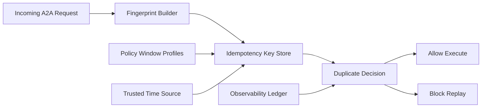

# A2A 幂等窗口选型 FAQ（Cycle 1855）

## 1) 3 分钟结论
- **核心矛盾：** 幂等窗口太短会漏拦重放请求，太长会抬高存储成本并误伤合法重试。
- **推荐：** 分级窗口（交互短窗/批处理长窗）+ 指纹去重 + 时钟漂移容忍。
- **目标：** 在高并发重试场景下同时控制重复执行风险与延迟成本。

## 2) Q1 / Q2 / Q3
### Q1：为什么“固定 24h 幂等窗口”不理想？
1) 不同任务重试周期差异大，统一窗口容易过度；
2) 长窗口增加键存储与查询开销；
3) 时钟偏移和跨区延迟会放大误判。

### Q2：生产级幂等窗口策略如何设计？
- **分级窗口：** 按操作类型定义 5m/30m/6h 等窗口；
- **请求指纹：** 结合 tenant、operation、payload-hash 生成去重键；
- **漂移容忍：** 允许小范围时间偏差并记录可信时间源；
- **过期回收：** 窗口结束后按批回收，防止索引膨胀。

### Q3：如何验证幂等策略有效？
- 重放拦截率提升；
- 合法重试误拦截率下降；
- 去重存储成本与查询时延稳定。

## 3) 架构图

## 4) 选型矩阵
| 维度 | 固定长窗口 | 分级幂等窗口（推荐） |
|---|---:|---:|
| 重放拦截能力 | 中 | 高 |
| 误拦截控制 | 低 | 高 |
| 成本可控性 | 低 | 高 |
| 实施复杂度 | 低 | 中 |
| 跨区鲁棒性 | 低 | 高 |

## 5) 证据与复算口径
- 证据文件：
  - `workshops/azure-agent-infra/evidence/cycle-1855-benchmark.json`
  - `workshops/azure-agent-infra/evidence/cycle-1855-latency.csv`
  - `workshops/azure-agent-infra/evidence/cycle-1855-throughput.csv`
  - `workshops/azure-agent-infra/evidence/cycle-1855-policy.csv`
- 标签：`measured / synthetic / anonymized_reported`。
- validation7：双语六段结构、7-card CSP 自包含、轮次与 evidence 一致、可回放链路通过。

## 6) 生产检查清单
- [ ] 操作分级窗口策略已固化。
- [ ] 指纹键构造与冲突处理规则已验证。
- [ ] 时钟漂移容忍与可信源切换可回放。
- [ ] 回收批处理对查询性能无负面回归。
- [ ] FAQ/H5/SVG/7-card 与 evidence 轮次一致。
