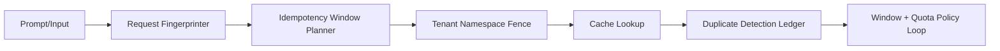

# Agent A2A 幂等窗口治理选型 FAQ（窄静态窗口 vs 自适应分层窗口）

## 1) 核心结论（先给负责人）
- **多租户生产默认采用“自适应分层幂等窗口 + 策略版本号”**，不建议仅用窄静态幂等窗口。
- **窄静态幂等窗口在重试风暴下去重稳定性不足**，容易放大回源压力与尾延迟。
- **幂等窗口治理必须与租户命名空间、去重策略、窗口/配额联动**，否则命中收益不可持续。

## 2) Q1 / Q2 / Q3（术语先通俗解释）
- **窄静态幂等窗口**：对用户输入直接哈希，键构造简单但对微小文本变体非常敏感。
- **自适应分层幂等窗口**：先归一化输入（模板、参数槽位、策略版本），再生成稳定键。

### Q1：为什么纯哈希键在生产里不稳？
第一性原理：不同工具链与租户流量的热度曲线不同，固定窄窗口会导致重复请求逃逸，放大下游执行与成本。，在流量抖动下放大回源与成本。

### Q2：什么时候可以接受窄静态幂等窗口？
单租户、输入模板严格固定、命中率目标不高且可容忍回源峰值时，可作为短期过渡。

### Q3：幂等窗口治理的最小安全闭环是什么？
请求指纹生成 -> 幂等键登记 -> 租户命名空间隔离 -> 重复检测账本 -> 窗口/配额调节 -> 审计回放。

## 3) Mermaid（A2A 幂等窗口治理闭环）

## 4) 决策矩阵
| 维度 | 窄静态幂等窗口 | 自适应分层幂等窗口 |
|---|---|---|
| 实现复杂度 | 低 | 中-高 |
| 命中率稳定性 | 低-中 | 高 |
| 回源放大控制 | 低 | 高 |
| 多租户隔离治理 | 中 | 高 |
| 生产默认建议 | 短期过渡 | 多租户长期运行 |

## 5) 数据证据与可复算算例（含 n/分母/来源）
> 本节百分比为 `synthetic_assumed` 假设算例（hypothetical），用于机制比较；生产机制认证仍为 `not_measured`。  
> 合同字段见：`workshops/azure-agent-infra/evidence/cycle-428-benchmark.json` 的 `percentage_contract`。

- 指标 A（未命中率，窄静态幂等窗口）  
  - 定义：`n_duplicate_escape_narrow / n_sessions_observed`  
  - 值：`256/2000 = 12.8%`（`synthetic_assumed`）  
  - 路径：`percentage_contract.narrow_window_duplicate_escape_rate`
- 指标 B（未命中率，自适应分层幂等窗口）  
  - 定义：`n_duplicate_escape_adaptive / n_sessions_observed`  
  - 值：`62/2000 = 3.1%`（`synthetic_assumed`）  
  - 路径：`percentage_contract.adaptive_window_duplicate_escape_rate`
- 指标 C（重复抑制收益，百分点）  
  - 定义：`(n_dedup_success_adaptive - n_dedup_success_narrow) / n_sessions_observed`  
  - 值：`(1704-1480)/2000 = 11.2` 个百分点（`synthetic_assumed`）  
  - 路径：`percentage_contract.cache_hit_gain_pts`

## 6) 生产 Checklist（上线前必须打勾）
- [ ] 幂等窗口策略含版本、灰度与回滚路径  
- [ ] 租户命名空间隔离与配额门禁在网关层生效  
- [ ] 去重策略与重复检测账本可审计可追溯  
- [ ] 指标口径标注 `synthetic_assumed` 与分母/单位，生产机制认证保持 `not_measured`  
