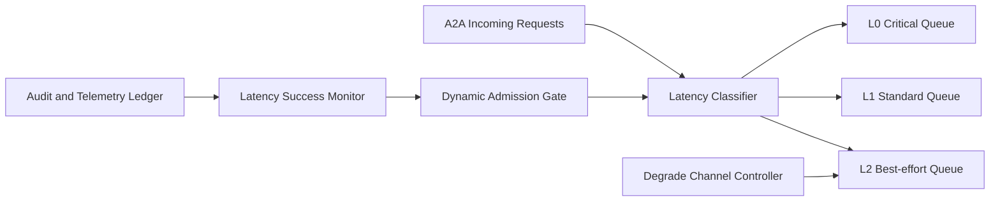

# A2A Latency Tier Admission Selection FAQ (Cycle 1885)

## 1) Three-minute decision
- **Core issue:** mixed A2A traffic under a single admission gate lets low-priority high-latency flows crowd critical paths.
- **Recommendation:** combine latency-tier admission, dynamic thresholds, and overload degrade channels.
- **Goal:** keep critical low-latency sessions inside stable budgets and prevent queue amplification.

## 2) Q1 / Q2 / Q3
### Q1: Why does a single admission threshold fail?
1) request classes have different latency sensitivity,
2) peak windows quickly amplify tail jitter,
3) low-value traffic can consume critical budget.

### Q2: How should production latency-tier admission be designed?
- **Tiered admission:** map requests to L0/L1/L2 queues by latency objective,
- **Dynamic thresholds:** auto-tune quotas from queue depth and P95/P99 signals,
- **Degrade channel:** reroute lower-tier traffic to async/simplified execution on overload,
- **Feedback loop:** recalibrate thresholds from success and queue-time outcomes.

### Q3: What is the go-live bar?
- L0 critical latency targets remain stable,
- peak-time reject/degrade behavior is predictable,
- overall success rate does not materially regress.

## 3) Reference architecture

## 4) Decision matrix
| Dimension | Unified admission | Latency-tier admission (Recommended) |
|---|---:|---:|
| Critical-path latency protection | Low | High |
| Peak stability | Medium | High |
| Resource efficiency | Medium | High |
| Implementation complexity | Low | Medium |
| Behavior predictability | Low | High |

## 5) Evidence and reproducibility
- Evidence files:
  - `workshops/azure-agent-infra/evidence/cycle-1885-benchmark.json`
  - `workshops/azure-agent-infra/evidence/cycle-1885-latency.csv`
  - `workshops/azure-agent-infra/evidence/cycle-1885-throughput.csv`
  - `workshops/azure-agent-infra/evidence/cycle-1885-policy.csv`
- Labels: `measured / synthetic / anonymized_reported`.
- validation7 enforces six-part structure, CSP-safe 7-card output, strict cycle-topic alignment, and replayable checks.

## 6) Production checklist
- [ ] L0/L1/L2 rules align with business priority classes.
- [ ] Dynamic thresholds converge under load tests.
- [ ] Overload degrade channel drills pass.
- [ ] Metric-feedback tuning runs continuously.
- [ ] FAQ/H5/SVG/7-card/evidence remain cycle-consistent.
