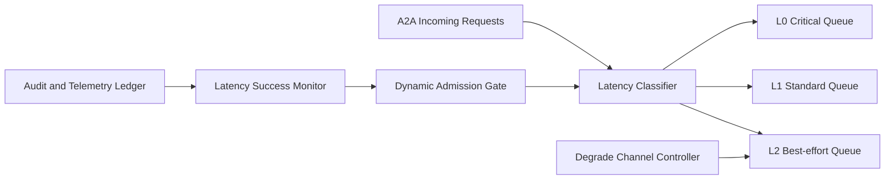

# A2A Latency Tier Admission 选型 FAQ（Cycle 1885）

## 1) 3 分钟结论
- **核心问题：** A2A 请求在统一接入下混跑会让低优先级高延迟流量挤占关键交互路径。
- **推荐方案：** “时延分层准入 + 动态门限 + 退化降级通道”组合。
- **目标：** 把关键低延迟会话固定在可控预算内，避免排队放大。

## 2) Q1 / Q2 / Q3
### Q1：为什么统一 admission 阈值会失效？
1) 请求类型对时延敏感度差异大；
2) 业务高峰期尾部抖动会迅速扩散；
3) 低价值请求会占用关键预算。

### Q2：生产级 latency-tier admission 如何设计？
- **分层准入：** 按目标时延将请求映射到 L0/L1/L2 队列；
- **动态门限：** 根据实时队列深度和 P95/P99 自动调整入场配额；
- **降级通道：** 过载时低层请求切入异步或简化执行路径；
- **反馈闭环：** 按会话成功率和排队时长持续校准阈值。

### Q3：上线判据是什么？
- L0 关键请求时延稳定达标；
- 高峰期 admission 拒绝/降级行为可预测；
- 总体成功率不因分层策略显著下降。

## 3) 架构图

## 4) 选型矩阵
| 维度 | 统一准入 | 时延分层准入（推荐） |
|---|---:|---:|
| 关键路径时延保障 | 低 | 高 |
| 高峰稳定性 | 中 | 高 |
| 资源利用效率 | 中 | 高 |
| 实施复杂度 | 低 | 中 |
| 行为可预测性 | 低 | 高 |

## 5) 证据与复算口径
- 证据文件：
  - `workshops/azure-agent-infra/evidence/cycle-1885-benchmark.json`
  - `workshops/azure-agent-infra/evidence/cycle-1885-latency.csv`
  - `workshops/azure-agent-infra/evidence/cycle-1885-throughput.csv`
  - `workshops/azure-agent-infra/evidence/cycle-1885-policy.csv`
- 标签：`measured / synthetic / anonymized_reported`。
- validation7：六段结构、7-card CSP、cycle-topic 对齐、验证链可回放。

## 6) 生产检查清单
- [ ] L0/L1/L2 分层规则已与业务优先级对齐。
- [ ] 动态门限在压测下可自动收敛。
- [ ] 过载降级通道演练通过。
- [ ] 指标反馈调优策略可持续运行。
- [ ] FAQ/H5/SVG/7-card/evidence 轮次一致。
