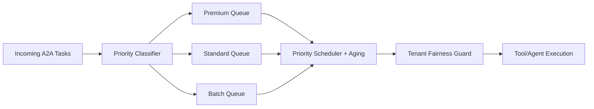

# Agent A2A Priority Queue Selection FAQ (Single FIFO vs Tiered Priority Queues + Fairness Guardrails)

## 1) Core conclusions
- **Tiered priority queues with fairness guardrails are the production default for multi-tenant A2A traffic**.
- **Single FIFO is acceptable only for low-concurrency homogeneous workloads**.
- **Priority scheduling must include aging promotion and tenant fairness floors** to avoid long-tail starvation.

## 2) Q1 / Q2 / Q3 (plain terms first)
- **FIFO**: first-in-first-out with no service differentiation.
- **Tiered priority queues**: high-priority tasks are served earlier, with explicit anti-starvation controls.

### Q1: Why can “fair-looking” FIFO still fail?
First principle: ordering fairness is not business-critical fairness. Critical flows and background traffic in one queue cause shared tail-latency collapse.

### Q2: When is FIFO still acceptable?
Short pipelines, homogeneous workloads, similar tenant classes, and low sensitivity to sporadic tail-latency spikes.

### Q3: What is the minimum safe control loop for tiered queues?
Task classification -> dequeue scheduling -> aging promotion -> tenant fairness floor enforcement -> telemetry and rollback hooks.

## 3) Mermaid (scheduling loop)

## 4) Decision matrix
| Dimension | Single FIFO | Tiered priority + fairness guardrails |
|---|---|---|
| Implementation complexity | Low | Medium-High |
| Critical-path latency protection | Low | High |
| Starvation risk | Medium | Low (with aging/floors) |
| Multi-tenant governance | Medium | High |
| Default production fit | Low-concurrency homogeneous traffic | Multi-tenant mixed traffic |

## 5) Evidence contract + recomputable examples (n/denominator/source)
> Percentages in this section are `synthetic_assumed` hypothetical examples for structural comparison; production live scheduling validation remains `not_measured`.  
> Field contract path: `workshops/azure-agent-infra/evidence/cycle-421-benchmark.json` -> `percentage_contract`.

- Metric A (critical timeout rate under FIFO)  
  - Formula: `n_timeout_fifo / n_critical_requests`  
  - Value: `188/2000 = 9.4%` (`synthetic_assumed`)  
  - Path: `percentage_contract.fifo_critical_timeout_rate`
- Metric B (critical timeout rate under tiered priority)  
  - Formula: `n_timeout_priority / n_critical_requests`  
  - Value: `74/2000 = 3.7%` (`synthetic_assumed`)  
  - Path: `percentage_contract.priority_critical_timeout_rate`
- Metric C (low-priority starvation improvement, percentage points)  
  - Formula: `(n_starved_fifo - n_starved_priority) / n_low_priority_requests`  
  - Value: `(132-46)/2000 = 4.3 percentage points` (`synthetic_assumed`)  
  - Path: `percentage_contract.starvation_rate_improvement_pts`

## 6) Production checklist
- [ ] Queue classification policy is versioned with rollout and rollback controls  
- [ ] Aging is enabled to prevent indefinite starvation  
- [ ] Tenant fairness floors are enforced and auditable  
- [ ] Metrics are tagged `synthetic_assumed` with denominator and units; production validation remains `not_measured`  
