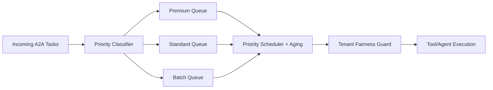

# Agent A2A 优先级队列选型 FAQ（单一 FIFO 队列 vs 分级优先队列+公平护栏）

## 1) 核心结论（先给决策者）
- **多租户生产默认采用分级优先队列 + 公平护栏**，不能只用单一 FIFO。
- **单一 FIFO 仅适用于低并发同质任务**，在突发高优先任务下会拖垮关键链路。
- **优先级策略必须绑定老化提升（aging）与租户配额底线**，否则会产生长期饥饿。

## 2) Q1 / Q2 / Q3（术语先通俗解释）
- **FIFO**：先到先服务，不区分任务等级。
- **分级优先队列**：高优先任务先处理，但要防止低优先任务永远排不到。

### Q1：为什么“看起来最公平”的 FIFO 还会失败？
第一性原理：公平不等于满足业务关键性。关键交易与普通任务抢同一队列时，尾延迟会同步恶化。

### Q2：什么场景还能继续用 FIFO？
链路短、任务同质、租户等级接近、且对偶发尾延迟不敏感时，FIFO 成本最低。

### Q3：分级优先队列的最小安全闭环是什么？
任务分级 -> 调度出队 -> 老化提升 -> 租户配额保护 -> 观测与回滚；缺一会演变为不公平或拥塞放大。

## 3) Mermaid（调度闭环）

## 4) 决策矩阵
| 维度 | 单一 FIFO | 分级优先队列 + 公平护栏 |
|---|---|---|
| 实现复杂度 | 低 | 中-高 |
| 关键链路延迟保障 | 低 | 高 |
| 饥饿风险 | 中 | 低（有老化/底线） |
| 多租户可治理性 | 中 | 高 |
| 生产默认建议 | 低并发同质流量 | 多租户混合流量 |

## 5) 数据证据与可复算算例（含 n/分母/来源）
> 本节百分比为 `synthetic_assumed` 假设算例（hypothetical），用于结构化比较；生产实时调度验证状态为 `not_measured`。  
> 合同字段见：`workshops/azure-agent-infra/evidence/cycle-421-benchmark.json` 的 `percentage_contract`。

- 指标 A（关键任务超时率，FIFO）  
  - 定义：`n_timeout_fifo / n_critical_requests`  
  - 值：`188/2000 = 9.4%`（`synthetic_assumed`）  
  - 路径：`percentage_contract.fifo_critical_timeout_rate`
- 指标 B（关键任务超时率，分级优先）  
  - 定义：`n_timeout_priority / n_critical_requests`  
  - 值：`74/2000 = 3.7%`（`synthetic_assumed`）  
  - 路径：`percentage_contract.priority_critical_timeout_rate`
- 指标 C（低优先任务饥饿率改善，百分点）  
  - 定义：`(n_starved_fifo - n_starved_priority) / n_low_priority_requests`  
  - 值：`(132-46)/2000 = 4.3` 个百分点（`synthetic_assumed`）  
  - 路径：`percentage_contract.starvation_rate_improvement_pts`

## 6) 生产 Checklist（上线前必须打勾）
- [ ] 队列分级规则有版本号、灰度策略与回滚路径  
- [ ] 调度器开启 aging，防止低优先任务永久饥饿  
- [ ] 租户配额底线（fairness floor）已配置并可审计  
- [ ] 指标口径已标注 `synthetic_assumed` 与分母/单位，生产验证保持 `not_measured`  
