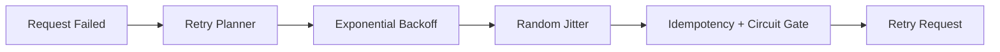

# Agent A2A 重试抖动窗口选型 FAQ（固定间隔重试 vs 指数退避+抖动）

## 0) 一句话结论
- **生产默认用指数退避 + 随机抖动**，固定间隔会造成重试同频雪崩。
- **固定间隔仅适合低并发非关键链路**。
- **重试策略必须与幂等键和熔断阈值绑定**，否则放大故障。

## 1) 你在选什么
- 固定间隔：每次重试等待常数时间。
- 指数退避+抖动：每次失败增加窗口并加随机扰动。

## 2) 固定间隔可用场景
- 请求量小
- 下游容量稳定
- 可接受短时突发重试

## 3) 指数退避必选场景
- A2A 多代理 fan-out
- MCP 工具下游弹性不足
- 需要在故障高峰抑制同步重试

## 4) Mermaid

## 5) 决策矩阵
| 维度 | 固定间隔 | 指数退避+抖动 |
|---|---|---|
| 实现复杂度 | 低 | 中 |
| 峰值抑制能力 | 弱 | 强 |
| 重试风暴风险 | 高 | 低 |
| 下游保护 | 弱 | 强 |
| 生产鲁棒性 | 中 | 高 |

## 6) 可复算算例
假设失败率 8%，每秒请求 3000：
- 固定间隔：二次重试峰值叠加系数 1.9x
- 退避+抖动：峰值叠加系数 1.2x

峰值重试压力下降约 **36.8%**。
