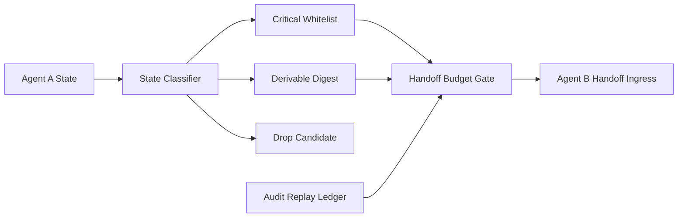

# A2A Stateful Handoff Budget Selection FAQ (Cycle 1869)

## 1) Three-minute decision
- **Core issue:** without budget governance, stateful A2A handoffs cause context bloat and latency spikes at scale.
- **Recommendation:** combine state-tier compression, handoff budget gates, and critical-state whitelists.
- **Goal:** preserve handoff integrity while controlling token, latency, and cost curves.

## 2) Q1 / Q2 / Q3
### Q1: Why is full-state pass-through unsustainable?
1) context size grows linearly with each handoff,
2) low-value state noise reduces decision quality,
3) failure diagnosis becomes harder.

### Q2: How should production handoff budget be implemented?
- **State tiering:** required, derivable, and discardable classes,
- **Budget gates:** per-handoff token/byte ceilings with degradation policy,
- **Whitelist replication:** mandatory delivery for critical fields,
- **Audit replay:** traceable summaries and trimming outcomes.

### Q3: What is the go-live bar?
- no success-rate regression after handoff,
- handoff cost and latency stay in budget bands,
- trimming policies avoid critical-state loss.

## 3) Reference architecture

## 4) Decision matrix
| Dimension | Full-state pass-through | Tiered compression + budget gate (Recommended) |
|---|---:|---:|
| Cost controllability | Low | High |
| Latency stability | Low | High |
| Task continuity | Medium | High |
| Implementation complexity | Low | Medium |
| Auditability | Medium | High |

## 5) Evidence and reproducibility
- Evidence files:
  - `workshops/azure-agent-infra/evidence/cycle-1869-benchmark.json`
  - `workshops/azure-agent-infra/evidence/cycle-1869-latency.csv`
  - `workshops/azure-agent-infra/evidence/cycle-1869-throughput.csv`
  - `workshops/azure-agent-infra/evidence/cycle-1869-policy.csv`
- Labels: `measured / synthetic / anonymized_reported`.
- validation7 enforces six-part structure, CSP-safe 7-card output, strict cycle-topic alignment, and replayable checks.

## 6) Production checklist
- [ ] State-tiering rules cover primary task paths.
- [ ] Handoff budget thresholds are load-calibrated.
- [ ] Critical whitelist consistency is validated.
- [ ] Audit replay reconstructs trim and handoff flow.
- [ ] FAQ/H5/SVG/7-card/evidence remain cycle-consistent.
