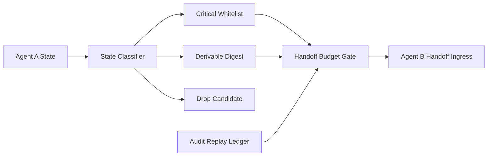

# A2A Stateful Handoff Budget 选型 FAQ（Cycle 1869）

## 1) 3 分钟结论
- **核心问题：** A2A 多代理状态交接若无预算治理，会在高并发下触发上下文膨胀与延迟陡增。
- **推荐方案：** “状态分层压缩 + handoff 预算闸门 + 关键状态白名单”组合。
- **目标：** 保持交接完整性的同时控制 token、延迟与成本曲线。

## 2) Q1 / Q2 / Q3
### Q1：为什么直接传全量状态不可持续？
1) 上下文尺寸线性累积，成本失控；
2) 低价值状态噪声污染决策质量；
3) 故障定位复杂度显著上升。

### Q2：生产级 handoff budget 应如何实现？
- **状态分层：** 必需状态、可推导状态、可丢弃状态分类；
- **预算闸门：** 每次交接 token/字节上限与降级策略；
- **白名单复制：** 强一致关键字段跨代理必达；
- **审计回放：** 交接摘要与裁剪结果可回溯。

### Q3：上线判据是什么？
- handoff 后任务成功率不下降；
- 平均交接成本与时延落入预算带；
- 裁剪策略不引发关键状态丢失。

## 3) 架构图

## 4) 选型矩阵
| 维度 | 全量状态直传 | 分层压缩+预算闸门（推荐） |
|---|---:|---:|
| 成本可控性 | 低 | 高 |
| 时延稳定性 | 低 | 高 |
| 任务连续性 | 中 | 高 |
| 实施复杂度 | 低 | 中 |
| 可审计性 | 中 | 高 |

## 5) 证据与复算口径
- 证据文件：
  - `workshops/azure-agent-infra/evidence/cycle-1869-benchmark.json`
  - `workshops/azure-agent-infra/evidence/cycle-1869-latency.csv`
  - `workshops/azure-agent-infra/evidence/cycle-1869-throughput.csv`
  - `workshops/azure-agent-infra/evidence/cycle-1869-policy.csv`
- 标签：`measured / synthetic / anonymized_reported`。
- validation7：六段结构、7-card CSP、cycle-topic 对齐、验证链可回放。

## 6) 生产检查清单
- [ ] 状态分层规则已覆盖主任务路径。
- [ ] handoff 预算闸门阈值经过压测校准。
- [ ] 关键状态白名单完成一致性验证。
- [ ] 审计回放可还原裁剪与交接过程。
- [ ] FAQ/H5/SVG/7-card/evidence 轮次一致。
