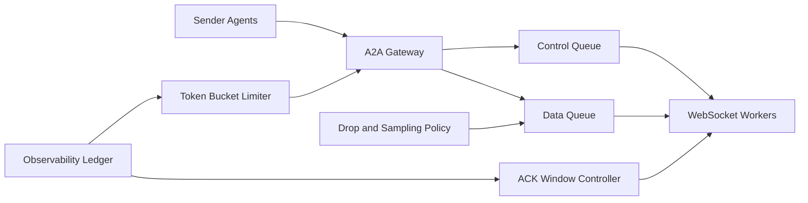

# A2A WebSocket Backpressure Selection FAQ (Cycle 1844)

## 1) Three-minute decision
- **Core tension:** A2A real-time channels need low latency, but burst traffic without backpressure causes queue buildup, memory blowup, and cascading timeouts.
- **Recommendation:** tiered queues, token-bucket throttling, ACK windows, and graceful drop policies.
- **Goal:** keep end-to-end latency bounded and prevent connection collapse during bursts.

## 2) Q1 / Q2 / Q3
### Q1: Why is “infinite buffering” not viable?
1) unbounded queues consume memory and destabilize nodes,
2) slow consumers propagate latency across the chain,
3) without prioritization, critical control messages are drowned out.

### Q2: What production-grade WebSocket backpressure architecture should be used?
- **Tiered queues:** separate control-plane and data-plane messages,
- **Token bucket throttling:** tenant/session rate shaping for bursts,
- **ACK windows:** cap in-flight unacknowledged messages,
- **Degrade policy:** drop/sample low-priority replayable messages.

### Q3: How do we prove it works?
- improved connection survival under peak load,
- lower P95 message latency and timeout ratio,
- balanced throttle-hit rate and business success rate.

## 3) Reference architecture

## 4) Decision matrix
| Dimension | Scale-only without backpressure | Tiered backpressure governance (Recommended) |
|---|---:|---:|
| Peak stability | Low | High |
| Connection survival | Low | High |
| Latency predictability | Low | High |
| Implementation complexity | Low | Medium |
| Multi-tenant fairness | Low | High |

## 5) Evidence and reproducibility
- Evidence files:
  - `workshops/azure-agent-infra/evidence/cycle-1844-benchmark.json`
  - `workshops/azure-agent-infra/evidence/cycle-1844-latency.csv`
  - `workshops/azure-agent-infra/evidence/cycle-1844-throughput.csv`
  - `workshops/azure-agent-infra/evidence/cycle-1844-policy.csv`
- Labels: `measured / synthetic / anonymized_reported`.
- validation7 enforces bilingual six-part structure, CSP self-contained 7-card output, strict cycle-evidence alignment, and replayability.

## 6) Production checklist
- [ ] Control/data queue tiering is active.
- [ ] Token-bucket shaping is enforced per tenant.
- [ ] ACK window and slow-consumer throttling are validated.
- [ ] Drop/sampling policy protects critical control messages.
- [ ] FAQ/H5/SVG/7-card align with cycle evidence.
