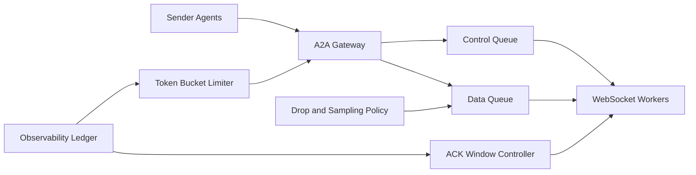

# A2A WebSocket 背压治理选型 FAQ（Cycle 1844）

## 1) 3 分钟结论
- **核心矛盾：** Agent-to-Agent 实时通道追求低延迟，但在流量突增时若无背压会触发消息堆积、内存膨胀和级联超时。
- **推荐：** 分级队列 + 令牌桶节流 + ACK 窗口 + 降级丢弃策略。
- **目标：** 保持端到端时延可控，并避免高峰期间连接雪崩。

## 2) Q1 / Q2 / Q3
### Q1：为什么“无限缓冲”不是可行方案？
1) 队列无限增长会侵占内存并拖垮节点；
2) 慢消费者会把延迟扩散到全链路；
3) 没有优先级区分会让关键控制消息被淹没。

### Q2：生产级 WebSocket 背压架构应该怎么做？
- **分级队列：** 控制面与数据面消息隔离；
- **令牌桶节流：** 按租户/会话限速，抑制突发；
- **ACK 窗口：** 限制未确认消息上限，超限触发降速；
- **降级策略：** 对低优先级可重放消息执行丢弃或采样。

### Q3：如何判断背压策略有效？
- 高峰期连接存活率上升；
- P95 消息时延与超时率下降；
- 节流命中率与业务成功率达到平衡。

## 3) 架构图

## 4) 选型矩阵
| 维度 | 无背压仅扩容 | 分级背压治理（推荐） |
|---|---:|---:|
| 峰值稳定性 | 低 | 高 |
| 连接存活率 | 低 | 高 |
| 时延可预测性 | 低 | 高 |
| 实施复杂度 | 低 | 中 |
| 多租户公平性 | 低 | 高 |

## 5) 证据与复算口径
- 证据文件：
  - `workshops/azure-agent-infra/evidence/cycle-1844-benchmark.json`
  - `workshops/azure-agent-infra/evidence/cycle-1844-latency.csv`
  - `workshops/azure-agent-infra/evidence/cycle-1844-throughput.csv`
  - `workshops/azure-agent-infra/evidence/cycle-1844-policy.csv`
- 标签：`measured / synthetic / anonymized_reported`。
- validation7：双语六段结构、7-card CSP 自包含、轮次与 evidence 一致、可回放链路通过。

## 6) 生产检查清单
- [ ] 控制面/数据面队列分级完成。
- [ ] 令牌桶限速参数按租户生效。
- [ ] ACK 窗口与慢消费者降速联动验证通过。
- [ ] 丢弃/采样策略对关键消息零误伤。
- [ ] FAQ/H5/SVG/7-card 与 evidence 轮次一致。
