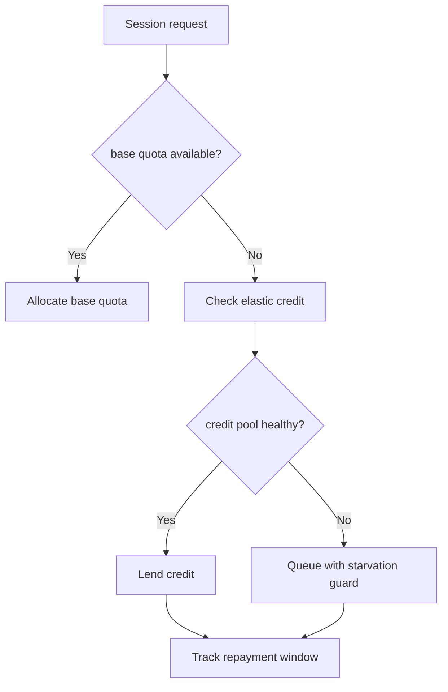
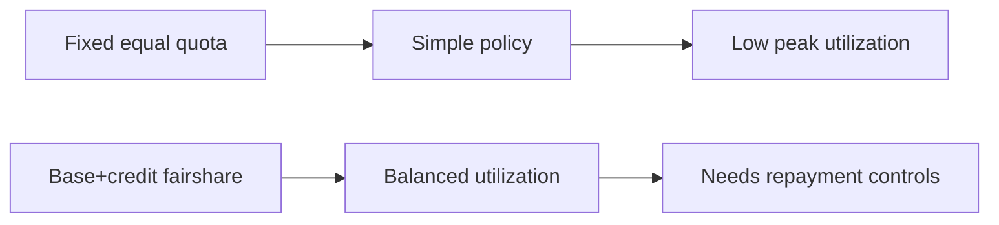
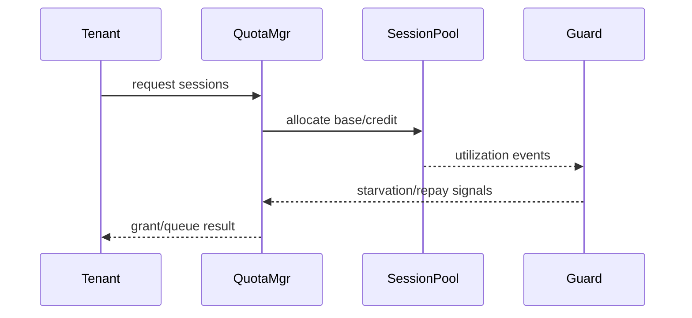

# Agent ACA Dynamic Session Quota Fairshare Selection FAQ (Azure AI Agent Infra)

## 1) 3-minute conclusions
- **ACA Dynamic Sessions needs fair-share quota under multi-tenant bursts, or contention and tail skew escalate.**
- **Use hard base quota + elastic credit layer + starvation guard.**
- **Targets: `tenant_starvation=0`, `p95_latency_skew <12%`, `quota_overrun <0.5%`.**

## 2) Q1 / Q2 / Q3
- **Why unfairness appears?** Burst tenants continuously consume elastic headroom.
- **Why not fixed equal quotas only?** Under-utilization causes waste.
- **Minimum loop?** Base allocation, credit lending, recovery and protection.

### Q1: When to trigger protection?
When starvation waiting crosses threshold.

### Q2: When to reclaim credits?
When tenant idle windows remain stable.

### Q3: How to measure gain?
Compare latency skew, starvation events, and utilization.

## 3) Mermaid diagrams
### 3.1 Decision tree

### 3.2 Path comparison

### 3.3 Sequence

## 4) Decision matrix
| Dimension | Fixed equal quota | Base+credit fairshare (Recommended) |
|---|---:|---:|
| Fairness | Medium | High |
| Utilization | Medium | High |
| Ops complexity (1-10) | 4 | 8 |
| Starvation risk | Medium | Low |
| Peak elasticity | Medium | High |

## 5) Quant model + 7-card insights
- Skew: `Skew = (TopTenantP95 - MedianP95) / MedianP95`
- Gain: `SkewGain = BaselineSkew - FairshareSkew`
- Example (`synthetic_assumed`):
  - `BaselineSkew=21%, FairshareSkew=9%`
  - `SkewGain=12%`
  - `QuotaOverrun=0.42%`
- Evidence:
  - `workshops/azure-agent-infra/evidence/cycle-1486-benchmark.json`
  - `workshops/azure-agent-infra/evidence/cycle-1486-sources.json`
- Labels: `official/synthetic_assumed/not_measured`.

## 6) Production verification checklist
- [ ] Base quota and credit ledger accounting is consistent
- [ ] Starvation guard alerts and actions are linked
- [ ] Credit reclaim windows and anti-flap controls are auditable
- [ ] Skew/overrun metrics are visible on dashboards
- [ ] FAQ/7-card source labels are complete
