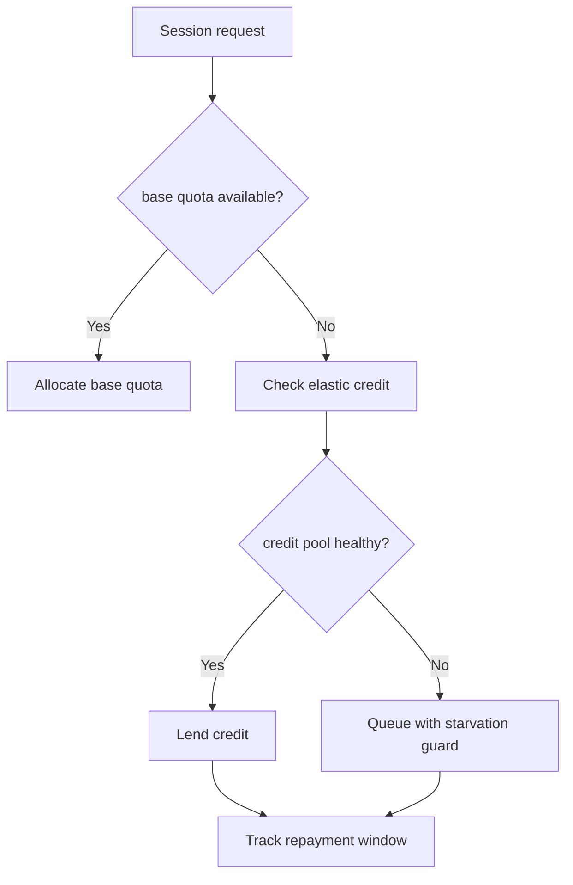
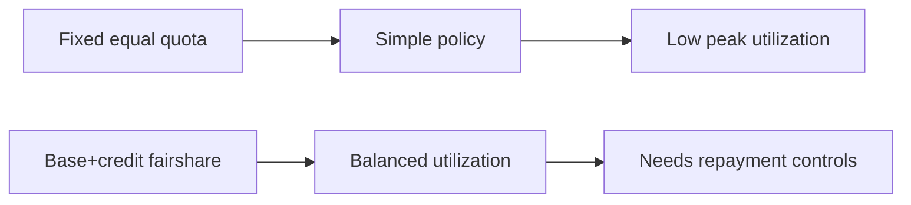
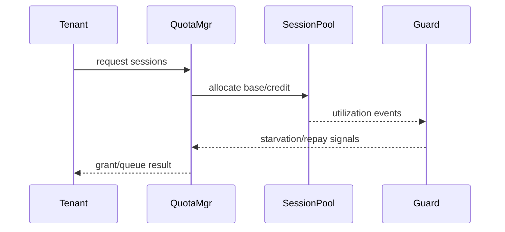

# Agent ACA Dynamic Session Quota Fairshare 选型 FAQ（Azure AI Agent Infra）

## 1) 3 分钟结论
- **ACA Dynamic Sessions 在多租户并发下需配额公平分摊，否则会出现抢占与尾延迟抖动。**
- **推荐“硬配额底座 + 弹性信用层 + 饥饿保护”三层模型。**
- **目标阈值：`tenant_starvation=0`、`p95_latency_skew <12%`、`quota_overrun <0.5%`。**

## 2) Q1 / Q2 / Q3
- **为何不公平？**：高峰租户持续占用可突发配额。
- **为何不能均分固定额度？**：低利用率时资源浪费明显。
- **最小闭环？**：硬底座、信用借贷、回收与保护。

### Q1：何时触发保护？
检测到饥饿租户等待超阈值。

### Q2：何时回收信用？
租户空闲窗口持续稳定。

### Q3：如何衡量收益？
比较延迟偏斜、饥饿事件与资源利用率。

## 3) Mermaid 图
### 3.1 决策树

### 3.2 路径对比

### 3.3 时序

## 4) 决策矩阵
| 维度 | 固定均分 | 底座+信用（推荐） |
|---|---:|---:|
| 公平性 | 中 | 高 |
| 资源利用率 | 中 | 高 |
| 运维复杂度（1-10） | 4 | 8 |
| 饥饿风险 | 中 | 低 |
| 峰值弹性 | 中 | 高 |

## 5) 定量算例与 7-Card 洞察
- 偏斜度：`Skew = (TopTenantP95 - MedianP95) / MedianP95`
- 收益：`SkewGain = BaselineSkew - FairshareSkew`
- 示例（`synthetic_assumed`）：
  - `BaselineSkew=21%, FairshareSkew=9%`
  - `SkewGain=12%`
  - `QuotaOverrun=0.42%`
- 证据：
  - `workshops/azure-agent-infra/evidence/cycle-1486-benchmark.json`
  - `workshops/azure-agent-infra/evidence/cycle-1486-sources.json`
- 标签：`official/synthetic_assumed/not_measured`。

## 6) 生产核验 Checklist
- [ ] base quota 与 credit 借贷账本一致
- [ ] starvation guard 告警和动作联动
- [ ] 信用回收窗口与防抖策略可审计
- [ ] 偏斜度与超额指标可视化
- [ ] FAQ/7-Card 来源标签完整
