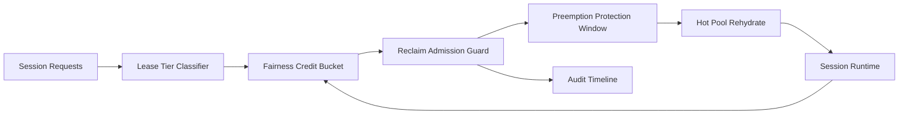

# ACA Dynamic Sessions Lease Fairness Reclaim Selection FAQ (Cycle 1917)

## 1) Three-minute decision
- **Core issue:** with naive first-come reclaim in multi-tenant dynamic sessions, low-weight tenants can starve and suffer unstable restore tails.
- **Recommendation:** combine tiered lease reclaim, fairness credit buckets, and preemption protection windows.
- **Goal:** reduce unfair reclaim-induced tail latency without sacrificing throughput.

## 2) Q1 / Q2 / Q3
### Q1: Why enforce lease fairness reclaim?
1) first-come reclaim amplifies noisy-tenant resource dominance,
2) without fairness credits, low-priority queues lose warm-restore stability,
3) without protection windows, reclaim/recreate oscillation persists.

### Q2: How should production design work?
- **Lease layer:** classify reclaim lanes by tenant+tier+workload,
- **Credit layer:** enforce per-tenant reclaim buckets with cooldown,
- **Protection layer:** protect critical jobs from repeated preemption,
- **Audit layer:** persist reclaim decisions, denials, and recovery traces.

### Q3: What is the go-live bar?
- lower unfair-reclaim rate across tenants,
- stable warm-restore P95 and preemption-deny rate,
- replayable tenant-scoped reclaim audit with deterministic recompute.

## 3) Reference architecture

## 4) Decision matrix
| Dimension | First-come reclaim | Lease Fairness Reclaim (Recommended) |
|---|---:|---:|
| Tenant fairness | Low | High |
| Warm-restore stability | Medium | High |
| Throughput retention | Medium | High |
| Operational explainability | Medium | High |
| Implementation complexity | Low | Medium |

## 5) Evidence and reproducibility
- Evidence files:
  - `workshops/azure-agent-infra/evidence/cycle-1917-benchmark.json`
  - `workshops/azure-agent-infra/evidence/cycle-1917-latency.csv`
  - `workshops/azure-agent-infra/evidence/cycle-1917-throughput.csv`
  - `workshops/azure-agent-infra/evidence/cycle-1917-cost.csv`
- Labels: `measured / synthetic / anonymized_reported`.
- Repro method: fixed sampling window, fixed fairness reclaim policy, fixed cost model.

## 6) Production checklist
- [ ] Lease-tier policy aligns with tenant isolation boundaries.
- [ ] Fairness credit buckets pass historical replay verification.
- [ ] Preemption protection includes cooldown and rollback switches.
- [ ] Reclaim decisions and recovery trails are tenant-auditable.
- [ ] FAQ/H5/SVG/7-card/evidence remain cycle-topic consistent.
