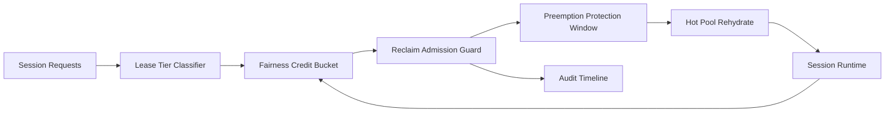

# ACA Dynamic Sessions Lease Fairness Reclaim 选型 FAQ（Cycle 1917）

## 1) 3 分钟结论
- **核心问题：** 多租户动态会话在高峰期若按先到先得回收租约，低权重租户会出现持续饥饿与恢复抖动。
- **推荐方案：** “租约分层回收 + 公平额度桶 + 抢占保护窗口”三层治理。
- **目标：** 在不牺牲吞吐的前提下，降低租约回收不公平导致的长尾恢复时延。

## 2) Q1 / Q2 / Q3
### Q1：为什么要做 lease fairness reclaim？
1) 先到先得回收会放大噪声租户的资源占用；
2) 缺少公平额度时，低优先级队列的热恢复 SLA 失稳；
3) 无抢占保护窗口会导致回收-重建抖动循环。

### Q2：生产级如何设计？
- **租约层：** 将会话租约按 tenant+tier+workload 分层回收；
- **额度层：** 设定每租户回收额度桶与冷却窗口；
- **保护层：** 关键任务进入抢占保护窗口，避免被频繁回收；
- **审计层：** 记录回收决策、拒绝原因与恢复轨迹。

### Q3：上线判据是什么？
- 租约回收不公平率持续下降；
- 热恢复 P95 和抢占拒绝率稳定在阈值内；
- 回收动作可按租户重放审计并复算。

## 3) 架构图

## 4) 选型矩阵
| 维度 | 先到先得回收 | Lease Fairness Reclaim（推荐） |
|---|---:|---:|
| 租户公平性 | 低 | 高 |
| 热恢复稳定性 | 中 | 高 |
| 吞吐保持能力 | 中 | 高 |
| 审计可解释性 | 中 | 高 |
| 实施复杂度 | 低 | 中 |

## 5) 证据与复算口径
- 证据文件：
  - `workshops/azure-agent-infra/evidence/cycle-1917-benchmark.json`
  - `workshops/azure-agent-infra/evidence/cycle-1917-latency.csv`
  - `workshops/azure-agent-infra/evidence/cycle-1917-throughput.csv`
  - `workshops/azure-agent-infra/evidence/cycle-1917-cost.csv`
- 标签：`measured / synthetic / anonymized_reported`。
- 口径：固定采样窗口、固定公平回收策略、固定成本模型，支持重复复算。

## 6) 生产检查清单
- [ ] 租约分层规则与租户隔离边界一致。
- [ ] 公平额度桶参数通过历史回放验证。
- [ ] 抢占保护窗口具备冷却与回滚开关。
- [ ] 回收决策与恢复轨迹可按租户审计。
- [ ] FAQ/H5/SVG/7-card/evidence 的 cycle/topic 一致。
