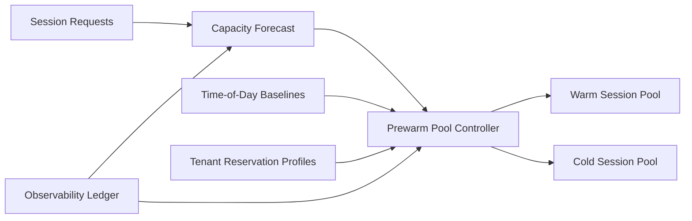

# ACA Dynamic Sessions Prewarm Selection FAQ (Cycle 1851)

## 1) Three-minute decision
- **Core tradeoff:** undersized prewarm pools cause startup queueing, while oversized pools increase idle-cost waste.
- **Recommendation:** time-sliced baseline prewarm, forecast-driven refill, and dual-threshold reclaim.
- **Goal:** stabilize first-response latency across demand shifts while keeping per-session cost predictable.

## 2) Q1 / Q2 / Q3
### Q1: Why is fixed prewarm sizing unsustainable?
1) demand profile shifts by time window,
2) session classes consume resources differently,
3) without proactive refill, bursts still hit cold-start paths.

### Q2: What production-grade Dynamic Sessions prewarm strategy should be used?
- **Time-sliced baselines:** separate baseline levels for peak and off-peak windows,
- **Forecast refill:** prefill based on near-real-time request rates and historical patterns,
- **Dual-threshold reclaim:** high-water reclaim plus low-water floor,
- **Tenant protection:** minimum warm reservations for critical tenants.

### Q3: How do we validate prewarm effectiveness?
- lower first-request cold-start P95,
- lower queue-timeout rate during burst windows,
- converged idle-capacity cost ratio within budget bands.

## 3) Reference architecture

## 4) Decision matrix
| Dimension | Fixed prewarm pool | Forecast-driven tiered prewarm (Recommended) |
|---|---:|---:|
| Cold-start control | Low | High |
| Peak elasticity | Low | High |
| Cost controllability | Medium | High |
| Implementation complexity | Low | Medium |
| Multi-tenant guarantees | Low | High |

## 5) Evidence and reproducibility
- Evidence files:
  - `workshops/azure-agent-infra/evidence/cycle-1851-benchmark.json`
  - `workshops/azure-agent-infra/evidence/cycle-1851-latency.csv`
  - `workshops/azure-agent-infra/evidence/cycle-1851-throughput.csv`
  - `workshops/azure-agent-infra/evidence/cycle-1851-policy.csv`
- Labels: `measured / synthetic / anonymized_reported`.
- validation7 enforces bilingual six-part structure, CSP self-contained 7-card output, strict cycle-evidence alignment, and replayability.

## 6) Production checklist
- [ ] Time-sliced baseline prewarm policy is active.
- [ ] Forecast refill parameters align with replay traces.
- [ ] Dual-threshold reclaim passes load testing.
- [ ] Critical-tenant reservation policy is enforced.
- [ ] FAQ/H5/SVG/7-card align with cycle evidence.
