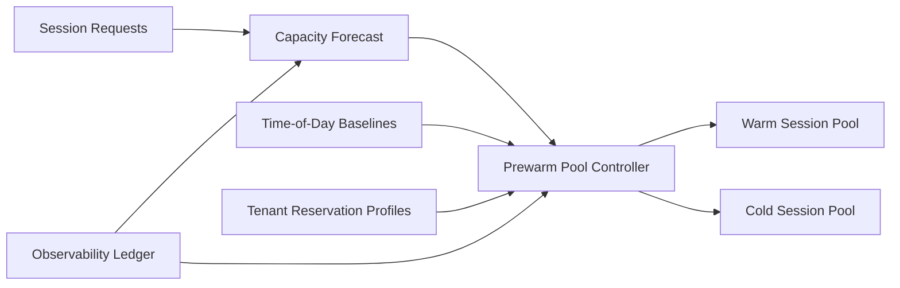

# ACA Dynamic Sessions 预热池选型 FAQ（Cycle 1851）

## 1) 3 分钟结论
- **核心矛盾：** 预热池过小会导致会话启动排队，过大则造成空转成本与容量浪费。
- **推荐：** 分时段基线预热 + 预测驱动补池 + 冷热双阈值回收。
- **目标：** 在业务峰谷切换中稳定首响应时延并控制单位会话成本。

## 2) Q1 / Q2 / Q3
### Q1：为什么固定预热池规模不可持续？
1) 流量时段变化大，固定规模无法覆盖峰谷；
2) 会话类型差异导致资源占用模型不一致；
3) 无预测补池时突发流量仍会触发冷启动抖动。

### Q2：生产级 Dynamic Sessions 预热策略如何设计？
- **分时段基线：** 工作时段与低谷时段采用不同 baseline；
- **预测补池：** 结合近实时请求率和历史模式提前补位；
- **双阈值回收：** 冷池高水位回收、低水位保底；
- **租户保护：** 关键租户设置最小预热保留额度。

### Q3：如何验证预热池策略有效？
- 首请求 P95 冷启动时延下降；
- 峰值时段排队超时率下降；
- 空闲资源成本占比收敛到预算区间。

## 3) 架构图

## 4) 选型矩阵
| 维度 | 固定预热池 | 预测驱动分层预热（推荐） |
|---|---:|---:|
| 冷启动控制 | 低 | 高 |
| 峰值弹性 | 低 | 高 |
| 成本可控性 | 中 | 高 |
| 实施复杂度 | 低 | 中 |
| 多租户保障 | 低 | 高 |

## 5) 证据与复算口径
- 证据文件：
  - `workshops/azure-agent-infra/evidence/cycle-1851-benchmark.json`
  - `workshops/azure-agent-infra/evidence/cycle-1851-latency.csv`
  - `workshops/azure-agent-infra/evidence/cycle-1851-throughput.csv`
  - `workshops/azure-agent-infra/evidence/cycle-1851-policy.csv`
- 标签：`measured / synthetic / anonymized_reported`。
- validation7：双语六段结构、7-card CSP 自包含、轮次与 evidence 一致、可回放链路通过。

## 6) 生产检查清单
- [ ] 分时段 baseline 预热策略已上线。
- [ ] 预测补池参数与回放结果一致。
- [ ] 冷热双阈值回收机制压测通过。
- [ ] 关键租户预留容量策略生效。
- [ ] FAQ/H5/SVG/7-card 与 evidence 轮次一致。
