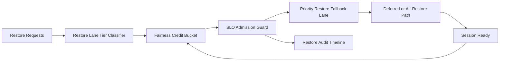

# ACA Dynamic Sessions Restore Lane Fairness SLO Selection FAQ (Cycle 1923)

## 1) Three-minute decision
- **Core issue:** under peak load, restore lanes without fairness SLO gating cause prolonged queueing and restore timeouts for low-weight tenants.
- **Recommendation:** combine tiered restore lanes, fairness credit buckets, and SLO-violation fallback routing.
- **Goal:** keep critical restore paths stable while reducing long-tail restore jitter.

## 2) Q1 / Q2 / Q3
### Q1: Why enforce restore-lane fairness SLO?
1) single restore lane amplifies high-frequency tenant contention,
2) without fairness credits, bursts become cascading queues,
3) without SLO fallback, critical restores degrade equally.

### Q2: How should production design work?
- **Tier layer:** partition restore lanes by tenant+tier+sessionclass,
- **Credit layer:** assign per-lane fairness credit buckets with refill cadence,
- **Fallback layer:** on SLO violations, degrade by criticality to alternate restore paths,
- **Audit layer:** persist queueing, violation, and recovery traces.

### Q3: What is the go-live bar?
- lower restore-lane unfairness and timeout rates,
- stable critical restore throughput in burst windows,
- replayable and auditable fairness/fallback actions.

## 3) Reference architecture

## 4) Decision matrix
| Dimension | Single restore lane + no fairness gate | Restore Lane Fairness SLO (Recommended) |
|---|---:|---:|
| Critical restore protection | Low | High |
| Peak stability | Medium | High |
| Restore cost control | Medium | High |
| Operational explainability | Medium | High |
| Implementation complexity | Low | Medium |

## 5) Evidence and reproducibility
- Evidence files:
  - `workshops/azure-agent-infra/evidence/cycle-1923-benchmark.json`
  - `workshops/azure-agent-infra/evidence/cycle-1923-latency.csv`
  - `workshops/azure-agent-infra/evidence/cycle-1923-throughput.csv`
  - `workshops/azure-agent-infra/evidence/cycle-1923-cost.csv`
- Labels: `measured / synthetic / anonymized_reported`.
- Repro method: fixed sampling window, fixed restore-lane fairness policy, fixed cost model.

## 6) Production checklist
- [ ] Restore-lane tiering aligns with tenant boundaries.
- [ ] Fairness-credit parameters pass historical replay verification.
- [ ] SLO fallback includes cooldown and rollback switches.
- [ ] Queue/violation/recover trails are tenant-auditable.
- [ ] FAQ/H5/SVG/7-card/evidence remain cycle-topic consistent.
