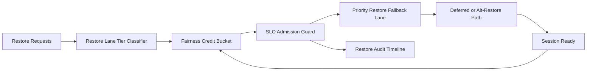

# ACA Dynamic Sessions Restore Lane Fairness SLO 选型 FAQ（Cycle 1923）

## 1) 3 分钟结论
- **核心问题：** 动态会话恢复车道在峰值时若缺少公平 SLO 门控，低权重租户会长期排队并触发恢复超时。
- **推荐方案：** “恢复车道分层 + 公平信用桶 + SLO 违规回退”三层治理。
- **目标：** 保持关键恢复路径稳定，并降低恢复长尾抖动。

## 2) Q1 / Q2 / Q3
### Q1：为什么要做 restore lane fairness SLO？
1) 单一恢复车道会放大高频租户占用；
2) 无公平信用桶时短时突发会造成级联排队；
3) 无 SLO 违规回退策略时，关键恢复请求同样退化。

### Q2：生产级如何设计？
- **分层层：** 按 tenant+tier+sessionclass 划分恢复车道；
- **信用层：** 每车道配置公平信用桶与回补周期；
- **回退层：** SLO 违规时按关键级别降级至备用恢复路径；
- **审计层：** 记录恢复排队、违规触发与恢复轨迹。

### Q3：上线判据是什么？
- 恢复车道不公平率与超时率持续下降；
- 高峰窗口关键恢复路径吞吐稳定；
- 公平门控与回退动作可审计、可重放、可复算。

## 3) 架构图

## 4) 选型矩阵
| 维度 | 单车道恢复 + 无公平门控 | Restore Lane Fairness SLO（推荐） |
|---|---:|---:|
| 关键恢复保障 | 低 | 高 |
| 峰值稳定性 | 中 | 高 |
| 恢复成本可控性 | 中 | 高 |
| 运维可解释性 | 中 | 高 |
| 实施复杂度 | 低 | 中 |

## 5) 证据与复算口径
- 证据文件：
  - `workshops/azure-agent-infra/evidence/cycle-1923-benchmark.json`
  - `workshops/azure-agent-infra/evidence/cycle-1923-latency.csv`
  - `workshops/azure-agent-infra/evidence/cycle-1923-throughput.csv`
  - `workshops/azure-agent-infra/evidence/cycle-1923-cost.csv`
- 标签：`measured / synthetic / anonymized_reported`。
- 口径：固定采样窗口、固定恢复车道公平策略、固定成本模型，支持重复复算。

## 6) 生产检查清单
- [ ] 恢复车道分层规则与租户边界一致。
- [ ] 公平信用桶参数通过历史回放验证。
- [ ] SLO 违规回退具备冷却与回滚开关。
- [ ] 排队/违规/恢复轨迹可按租户审计。
- [ ] FAQ/H5/SVG/7-card/evidence 的 cycle/topic 一致。
