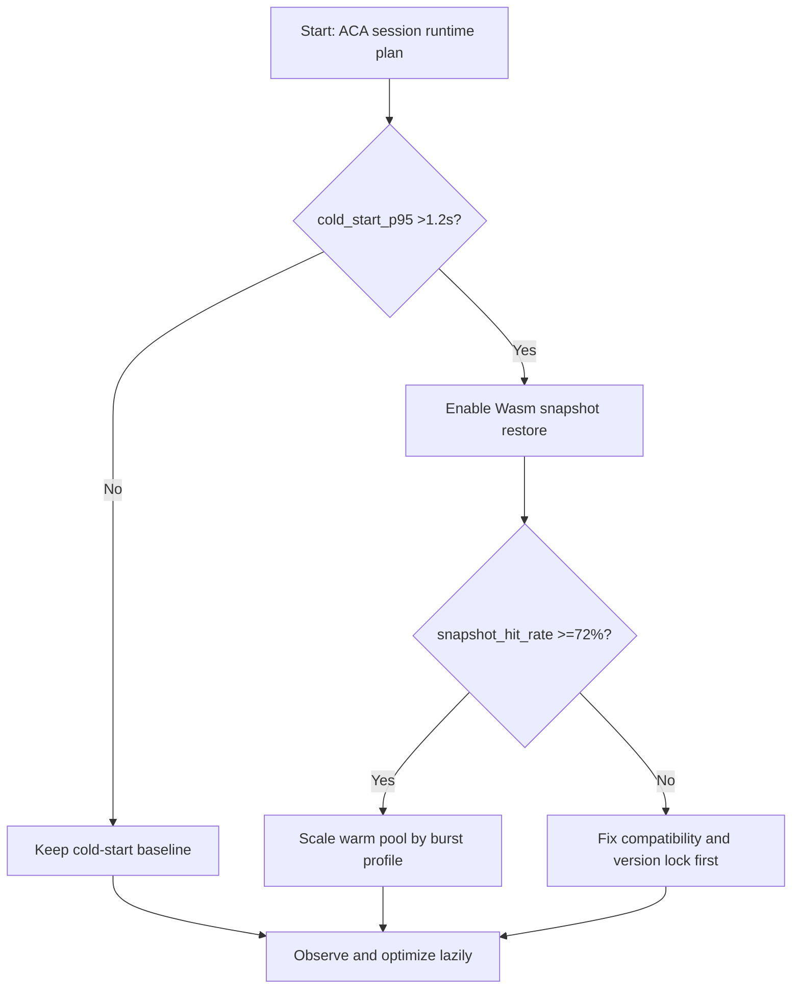
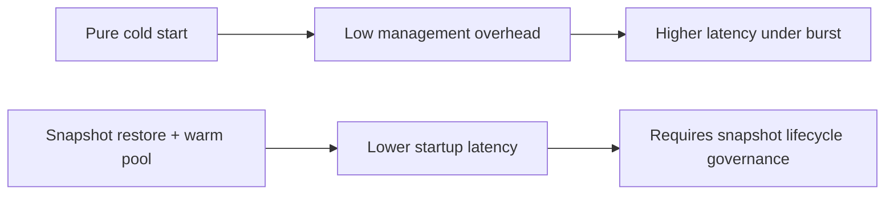
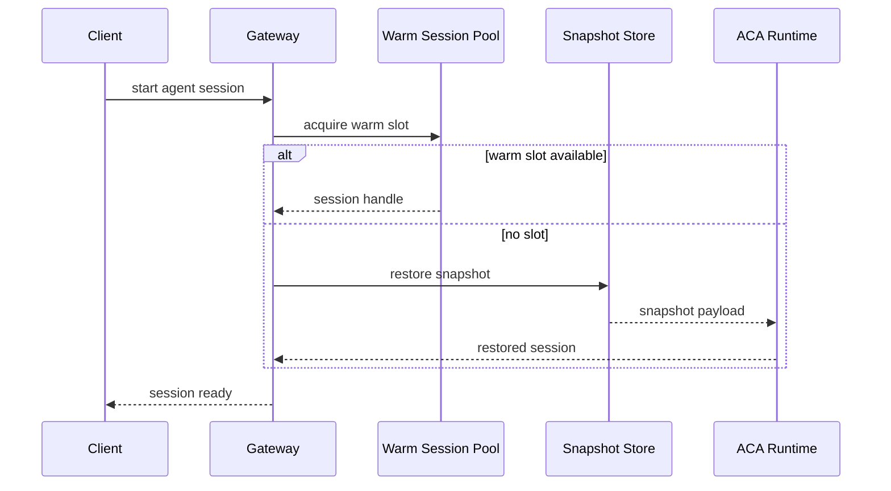

# Agent ACA Dynamic Sessions Wasm Snapshot Restore Selection FAQ (Azure AI Agent Infra)

## 1) 3-minute conclusions
- **If cold-start P95 exceeds 1.2s and burst concurrency exceeds 3x baseline, prioritize Wasm snapshot restore with warm-pool reuse** over raw instance scaling.
- **If snapshot restore failures exceed 0.8%, fix snapshot/runtime compatibility and version matrix first** before increasing pool size.
- **Production baseline: snapshot hit-rate >=72%, restore P95 <=420ms, state-drift alerts <0.3%**.

## 2) Q1 / Q2 / Q3
- **What snapshot restore really does?** Moves initialization cost left into build/prewarm stages.
- **Why failures happen?** Version drift, missing dependencies, incompatible state serialization.
- **Minimum viable policy?** Version lock, dual-slot snapshot rollout, deterministic fallback to cold start.

### Q1: When is warm pool mandatory?
When minute-level concurrency variance exceeds 2.5 and SLO is startup-sensitive.

### Q2: When is cold start still fine?
Low-frequency background jobs with cheap initialization.

### Q3: How to control cost?
Optimize around hit-rate and reuse duration; avoid over-idling warm pools.

## 3) Mermaid diagrams
### 3.1 Decision tree

### 3.2 Path comparison

### 3.3 Sequence

## 4) Decision matrix
| Dimension | Cold start | Snapshot restore + warm pool (Recommended) |
|---|---:|---:|
| Startup P95 | 0.9–1.8s | 0.22–0.48s |
| Burst elasticity | Medium | High |
| Snapshot governance complexity | Low | Medium-high |
| Cost stability | Medium | High (with target hit-rate) |
| Failure fallback | Simple | Needs dual-slot/version governance |

## 5) Quant model + 7-card insights
- Startup gain: `Saved = ColdStart - RestoreTime`
- Warm-pool overhead: `PoolCost = WarmSlots * SlotCostPerMin * IdleFactor`
- Example (`synthetic_assumed`):
  - `ColdStart=1320ms, Restore=360ms`
  - `Saved=960ms`
  - `WarmSlots=48, SlotCostPerMin=$0.0014, IdleFactor=0.37`
  - `PoolCost≈$0.0249/min`
- Evidence pointers:
  - `workshops/azure-agent-infra/evidence/cycle-1451-benchmark.json`
  - `workshops/azure-agent-infra/evidence/cycle-1451-sources.json`
- Labels: `official/synthetic_assumed/not_measured`.

## 6) Production verification checklist
- [ ] Snapshot/runtime version matrix is pinned and validated
- [ ] Snapshot restore failure fallback to cold start is tested
- [ ] Warm-pool autoscaling follows minute-level burst profile
- [ ] Hit-rate, restore latency, and drift signals have independent alerts
- [ ] FAQ and 7-card carry source labels and measurement boundaries
