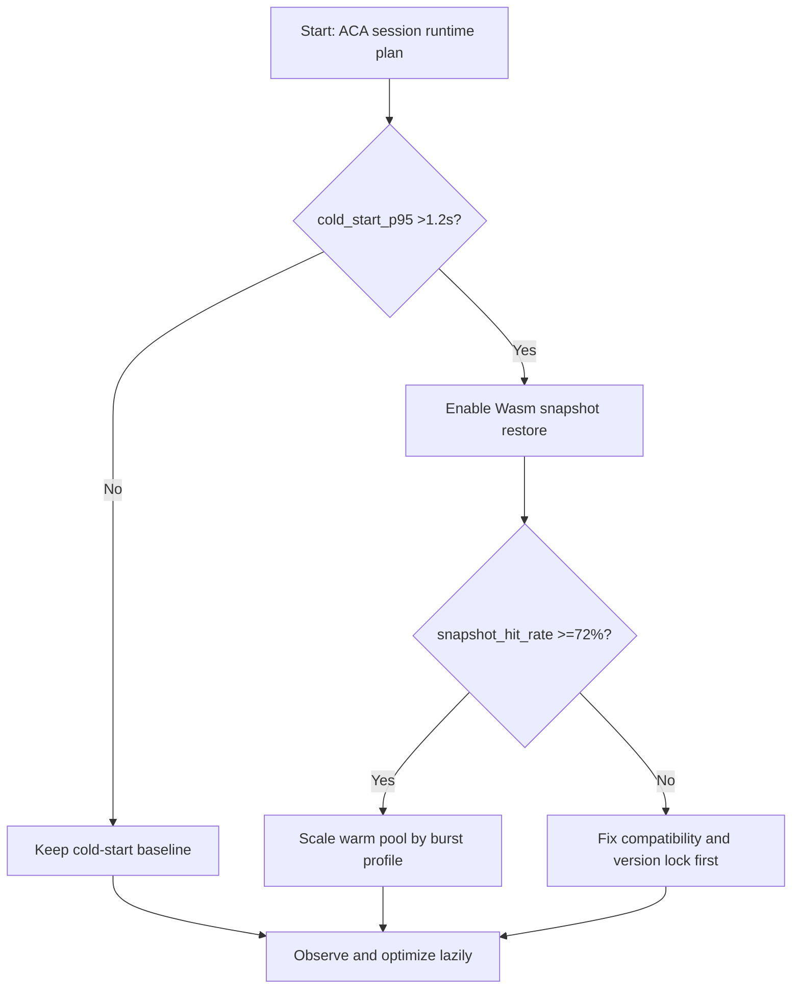
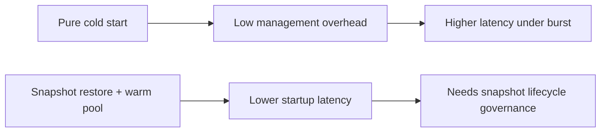
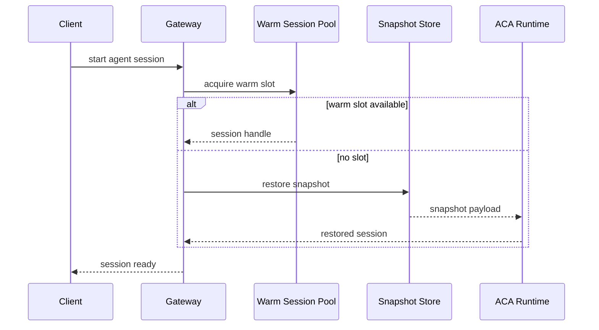

# Agent ACA Dynamic Sessions Wasm Snapshot Restore 选型 FAQ（Azure AI Agent Infra）

## 1) 3 分钟结论
- **当会话冷启动 P95 >1.2s 且突发并发 >3x 基线时，优先“Wasm 快照恢复 + 热池复用”而非单纯扩容实例数**。
- **若快照恢复失败率 >0.8%，先收敛快照版本矩阵与运行时兼容性，再扩大池规模**。
- **生产默认门槛：快照命中率 ≥72%、恢复 P95 ≤420ms、状态漂移告警 <0.3%**。

## 2) Q1 / Q2 / Q3
- **快照恢复的本质？**：把初始化成本前移到构建或预热阶段。
- **为什么会失败？**：组件版本漂移、依赖缺失、状态序列化不兼容。
- **最小可用策略？**：版本锁定、双槽快照发布、恢复回退到冷启。

### Q1：何时必须启用热池？
当分钟级并发波动系数 >2.5 且响应 SLO 对冷启动敏感时。

### Q2：何时仍建议冷启？
低频后台任务且状态初始化成本很低的场景。

### Q3：如何控成本？
以命中率和复用时长为核心，控制热池过度空转。

## 3) Mermaid 图
### 3.1 决策树

### 3.2 路径对比

### 3.3 时序

## 4) 决策矩阵
| 维度 | 冷启 | 快照恢复+热池（推荐） |
|---|---:|---:|
| 启动 P95 | 0.9–1.8s | 0.22–0.48s |
| 突发弹性 | 中 | 高 |
| 快照治理复杂度 | 低 | 中高 |
| 成本稳定性 | 中 | 高（命中率达标时） |
| 故障回退路径 | 简单 | 需双槽/版本治理 |

## 5) 定量算例与 7-Card 洞察
- 启动节省：`Saved = ColdStart - RestoreTime`
- 热池成本：`PoolCost = WarmSlots * SlotCostPerMin * IdleFactor`
- 示例（`synthetic_assumed`）：
  - `ColdStart=1320ms, Restore=360ms`
  - `Saved=960ms`
  - `WarmSlots=48, SlotCostPerMin=$0.0014, IdleFactor=0.37`
  - `PoolCost≈$0.0249/min`
- 证据文件：
  - `workshops/azure-agent-infra/evidence/cycle-1451-benchmark.json`
  - `workshops/azure-agent-infra/evidence/cycle-1451-sources.json`
- 标签：`official/synthetic_assumed/not_measured`。

## 6) 生产核验 Checklist
- [ ] 快照版本与运行时版本矩阵已锁定
- [ ] 快照恢复失败自动回退冷启路径已验证
- [ ] 热池容量按分钟级 burst profile 自动伸缩
- [ ] 命中率、恢复耗时、状态漂移有独立告警
- [ ] 7-Card 与 FAQ 标注来源和测量边界
