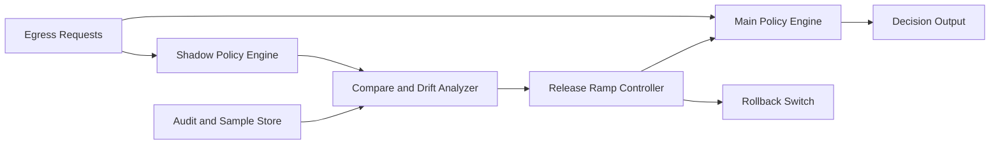

# ACA Egress Policy Shadow Release Selection FAQ (Cycle 1881)

## 1) Three-minute decision
- **Core issue:** direct egress-policy cutovers are risky and can trigger false blocks and cascading rollback.
- **Recommendation:** shadow release with dual-path comparison and phased convergence rollout.
- **Goal:** validate new policy behavior under real traffic without impacting the primary decision path.

## 2) Q1 / Q2 / Q3
### Q1: Why is percent-based canary alone insufficient?
1) canary samples may be biased,
2) peak-condition failure shapes differ,
3) without a baseline, policy gains/side-effects are hard to quantify.

### Q2: How should production shadow release be designed?
- **Dual-path execution:** main policy decides, shadow policy evaluates in parallel,
- **Result comparison:** monitor allow/deny divergence and false-positive samples,
- **Phased ramp:** expand effective scope after stable divergence metrics,
- **Auto rollback:** halt rollout and revert on threshold breach.

### Q3: What is the go-live bar?
- divergence and false-positive rates stay within thresholds,
- no regression in key business success during ramp,
- rollback drills complete within the defined window.

## 3) Reference architecture

## 4) Decision matrix
| Dimension | Direct cutover | Shadow phased release (Recommended) |
|---|---:|---:|
| Release-risk control | Low | High |
| False-block suppression | Low | High |
| Rollback readiness | Medium | High |
| Implementation complexity | Low | Medium |
| Explainability | Medium | High |

## 5) Evidence and reproducibility
- Evidence files:
  - `workshops/azure-agent-infra/evidence/cycle-1881-benchmark.json`
  - `workshops/azure-agent-infra/evidence/cycle-1881-latency.csv`
  - `workshops/azure-agent-infra/evidence/cycle-1881-throughput.csv`
  - `workshops/azure-agent-infra/evidence/cycle-1881-policy.csv`
- Labels: `measured / synthetic / anonymized_reported`.
- validation7 enforces six-part structure, CSP-safe 7-card output, strict cycle-topic alignment, and replayable checks.

## 6) Production checklist
- [ ] Shadow and main policy paths run in parallel correctly.
- [ ] Divergence metrics and thresholds are defined.
- [ ] Phased rollout strategy passes stress tests.
- [ ] Auto/manual rollback paths meet time-window requirements.
- [ ] FAQ/H5/SVG/7-card/evidence remain cycle-consistent.
