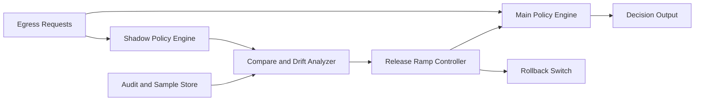

# ACA Egress Policy Shadow Release 选型 FAQ（Cycle 1881）

## 1) 3 分钟结论
- **核心问题：** 出站策略直接切换上线风险高，容易在真实流量下引发误拦截与连锁回退。
- **推荐方案：** “影子发布（shadow release）+ 双轨比对 + 分阶段收敛放量”。
- **目标：** 在不影响主路径的前提下验证新策略有效性并降低发布风险。

## 2) Q1 / Q2 / Q3
### Q1：为什么灰度比例切流仍可能不够安全？
1) 灰度流量样本可能偏窄；
2) 真实峰值条件下异常形态不同；
3) 缺少对照基线时难判断策略收益与副作用。

### Q2：生产级 shadow release 如何设计？
- **双轨执行：** 主策略生效，新策略影子执行不影响决策；
- **结果比对：** 实时对比 allow/deny 差异与误报样本；
- **分阶段放量：** 差异稳定后逐层扩大生效范围；
- **自动回退：** 差异异常超阈值立即停止放量并回退。

### Q3：上线判据是什么？
- 影子期差异率与误报率在阈值内；
- 放量后关键业务成功率无下降；
- 回退链路演练可在窗口内完成。

## 3) 架构图

## 4) 选型矩阵
| 维度 | 直接切换发布 | 影子发布分阶段（推荐） |
|---|---:|---:|
| 发布风险控制 | 低 | 高 |
| 误拦截抑制 | 低 | 高 |
| 可回滚性 | 中 | 高 |
| 实施复杂度 | 低 | 中 |
| 可解释性 | 中 | 高 |

## 5) 证据与复算口径
- 证据文件：
  - `workshops/azure-agent-infra/evidence/cycle-1881-benchmark.json`
  - `workshops/azure-agent-infra/evidence/cycle-1881-latency.csv`
  - `workshops/azure-agent-infra/evidence/cycle-1881-throughput.csv`
  - `workshops/azure-agent-infra/evidence/cycle-1881-policy.csv`
- 标签：`measured / synthetic / anonymized_reported`。
- validation7：六段结构、7-card CSP、cycle-topic 对齐、验证链可回放。

## 6) 生产检查清单
- [ ] 影子执行链路与主链路并行运行正常。
- [ ] 差异比对指标与阈值定义完成。
- [ ] 分阶段放量策略压测通过。
- [ ] 自动回退与手动回退均可在窗口内执行。
- [ ] FAQ/H5/SVG/7-card/evidence 轮次一致。
