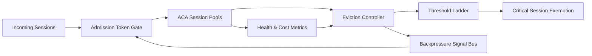

# ACA Eviction Backpressure Selection FAQ (Cycle 1898)

## 1) Three-minute decision
- **Core issue:** when ACA session pools face memory/connection pressure, decoupled eviction and admission control can trigger an eviction-rebuild storm loop.
- **Recommendation:** combine graded eviction thresholds, token-based backpressure gates, and critical-session exemptions.
- **Goal:** keep interruption rate, rebuild storms, and cost variance within SLO during pressure windows.

## 2) Q1 / Q2 / Q3
### Q1: Why must eviction be coupled with backpressure?
1) eviction alone handles stock, not incoming load,
2) without ingress backpressure new sessions keep arriving,
3) rebuild after eviction can amplify cold-start pressure.

### Q2: How should production coupling be implemented?
- **Threshold ladder:** warning/degrade/protect eviction tiers,
- **Token gating:** tighten admission tokens from pool health signals,
- **Critical exemption:** reserve capacity and delayed eviction for core sessions,
- **Recovery pacing:** reopen ingress gradually after pressure drops.

### Q3: What is the go-live bar?
- converged interruption and rejection rates under load,
- predictable rebuild velocity in recovery windows,
- no abnormal rise in per-session cost and tail latency.

## 3) Reference architecture

## 4) Decision matrix
| Dimension | Eviction only | Eviction + Backpressure (Recommended) |
|---|---:|---:|
| High-pressure stability | Low | High |
| Rebuild-storm suppression | Low | High |
| Critical continuity | Medium | High |
| Implementation complexity | Low | Medium |
| Cost predictability | Medium | High |

## 5) Evidence and reproducibility
- Evidence files:
  - `workshops/azure-agent-infra/evidence/cycle-1898-benchmark.json`
  - `workshops/azure-agent-infra/evidence/cycle-1898-latency.csv`
  - `workshops/azure-agent-infra/evidence/cycle-1898-throughput.csv`
  - `workshops/azure-agent-infra/evidence/cycle-1898-cost.csv`
- Labels: `measured / synthetic / anonymized_reported`.
- Validation chain: six-part FAQ, CSP, cycle/topic binding, simulator checks.

## 6) Production checklist
- [ ] Eviction tiers are bound to pool-health metrics.
- [ ] Backpressure token gate converges with bounded recovery rate.
- [ ] Critical-session exemptions pass failure drills.
- [ ] Eviction/backpressure events are fully auditable.
- [ ] FAQ/H5/SVG/7-card/evidence remain cycle-consistent.
