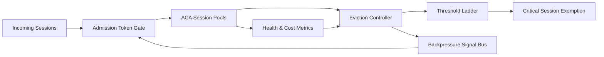

# ACA Eviction Backpressure 选型 FAQ（Cycle 1898）

## 1) 3 分钟结论
- **核心问题：** ACA 会话池在内存和连接压力上升时，如果驱逐策略与入口限流解耦，会出现“先驱逐再风暴重建”的连锁放大。
- **推荐方案：** “驱逐阈值分级 + 回压令牌门控 + 关键会话豁免”协同机制。
- **目标：** 将高压窗口的中断率、重建风暴和成本波动控制在 SLO 范围内。

## 2) Q1 / Q2 / Q3
### Q1：为什么 eviction 必须和 backpressure 联动？
1) 单独驱逐只处理存量，不控制增量请求；
2) 入口不回压会持续注入新会话；
3) 驱逐后的重建会反向加剧冷启动压力。

### Q2：生产级联动方案怎么落地？
- **分级阈值：** warning/degrade/protect 三段驱逐阈值；
- **令牌门控：** 根据池健康度动态收紧 admission token；
- **关键豁免：** 对核心业务会话设置保留容量与延迟驱逐；
- **恢复节奏：** 压力回落后按速率逐步放开入口。

### Q3：上线判据是什么？
- 压测下会话中断率和拒绝率双收敛；
- 恢复窗口内重建速率可预测；
- 单会话成本与尾延迟无异常抬升。

## 3) 架构图

## 4) 选型矩阵
| 维度 | 单独驱逐 | Eviction + Backpressure（推荐） |
|---|---:|---:|
| 高压稳定性 | 低 | 高 |
| 重建风暴抑制 | 低 | 高 |
| 关键业务连续性 | 中 | 高 |
| 实施复杂度 | 低 | 中 |
| 成本可预测性 | 中 | 高 |

## 5) 证据与复算口径
- 证据文件：
  - `workshops/azure-agent-infra/evidence/cycle-1898-benchmark.json`
  - `workshops/azure-agent-infra/evidence/cycle-1898-latency.csv`
  - `workshops/azure-agent-infra/evidence/cycle-1898-throughput.csv`
  - `workshops/azure-agent-infra/evidence/cycle-1898-cost.csv`
- 标签：`measured / synthetic / anonymized_reported`。
- 校验链：FAQ 六段、CSP、cycle/topic 绑定、模拟器检查。

## 6) 生产检查清单
- [ ] 驱逐阈值分级与池健康指标已绑定。
- [ ] 回压令牌门控具备动态收敛与恢复速率限制。
- [ ] 关键会话豁免策略经故障演练验证。
- [ ] 驱逐/回压事件具备完整审计轨迹。
- [ ] FAQ/H5/SVG/7-card/evidence 轮次一致。
