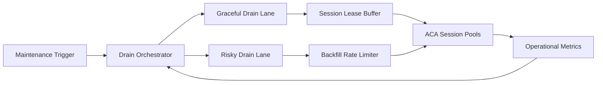

# ACA Fleet Drain Protection Selection FAQ (Cycle 1896)

## 1) Three-minute decision
- **Core issue:** during ACA fleet maintenance or scale drain phases, missing protection controls can trigger session drops and rebuild storms.
- **Recommendation:** combine graded drain lanes, session lease buffering, and backfill rate limiting.
- **Goal:** keep maintenance impact bounded while preserving success rate and cost stability.

## 2) Q1 / Q2 / Q3
### Q1: Why do drain phases amplify failures?
1) concurrent migrations destabilize destination pools,
2) no lease buffer causes cascading timeouts,
3) unlimited backfill amplifies cold-start pressure.

### Q2: How should production drain protection work?
- **Graded drain:** split graceful and risky drain paths,
- **Lease buffer:** temporarily extend session TTL in migration windows,
- **Backfill limiter:** cap replacement concurrency and rate,
- **Observability loop:** track migration success, refill latency, and interruption rate.

### Q3: What is the go-live bar?
- session success remains within SLO during maintenance,
- stable P95 recovery after drain events,
- controlled refill cost and cold-start peaks.

## 3) Reference architecture

## 4) Decision matrix
| Dimension | Unprotected drain | Drain Protection (Recommended) |
|---|---:|---:|
| Session continuity | Low | High |
| Recovery predictability | Low | High |
| Maintenance risk | High | Low |
| Implementation complexity | Low | Medium |
| Cost controllability | Medium | High |

## 5) Evidence and reproducibility
- Evidence files:
  - `workshops/azure-agent-infra/evidence/cycle-1896-benchmark.json`
  - `workshops/azure-agent-infra/evidence/cycle-1896-latency.csv`
  - `workshops/azure-agent-infra/evidence/cycle-1896-throughput.csv`
  - `workshops/azure-agent-infra/evidence/cycle-1896-cost.csv`
- Labels: `measured / synthetic / anonymized_reported`.
- Validation chain: six-part FAQ, CSP, cycle/topic binding, simulator checks.

## 6) Production checklist
- [ ] Drain-grade rules map to maintenance classes.
- [ ] Lease-buffer windows and timeout caps are load-tested.
- [ ] Backfill limiter is integrated with quota controls.
- [ ] Migration/interruption events are batch-traceable.
- [ ] FAQ/H5/SVG/7-card/evidence stay cycle-consistent.
