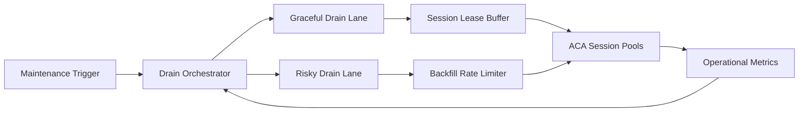

# ACA Fleet Drain Protection 选型 FAQ（Cycle 1896）

## 1) 3 分钟结论
- **核心问题：** ACA 会话舰队在节点维护或扩缩容 drain 阶段，若缺少保护策略会触发会话中断与重建风暴。
- **推荐方案：** “有损/无损 drain 分级 + 会话续租缓冲 + 回填限速器”三段保护。
- **目标：** 将维护窗口影响压缩到可控范围，保持会话成功率与成本稳定。

## 2) Q1 / Q2 / Q3
### Q1：为什么 drain 阶段容易出现放大故障？
1) 大量会话同时迁移导致目的池抖动；
2) 无续租缓冲会触发级联超时；
3) 回填无节流会放大冷启动压力。

### Q2：生产级 drain protection 如何设计？
- **分级 drain：** 区分无损迁移与有损回收路径；
- **续租缓冲：** 在迁移窗口短时延长会话 TTL；
- **回填限速：** 控制新实例补位速率与并发；
- **闭环观测：** 跟踪迁移成功率、回填时延、会话中断率。

### Q3：上线判据是什么？
- 维护期间会话成功率维持 SLO；
- drain 触发后 P95 恢复时间稳定；
- 回填成本与冷启动峰值受控。

## 3) 架构图

## 4) 选型矩阵
| 维度 | 无保护 drain | Drain Protection（推荐） |
|---|---:|---:|
| 会话连续性 | 低 | 高 |
| 恢复可预测性 | 低 | 高 |
| 维护窗口风险 | 高 | 低 |
| 实施复杂度 | 低 | 中 |
| 成本可控性 | 中 | 高 |

## 5) 证据与复算口径
- 证据文件：
  - `workshops/azure-agent-infra/evidence/cycle-1896-benchmark.json`
  - `workshops/azure-agent-infra/evidence/cycle-1896-latency.csv`
  - `workshops/azure-agent-infra/evidence/cycle-1896-throughput.csv`
  - `workshops/azure-agent-infra/evidence/cycle-1896-cost.csv`
- 标签：`measured / synthetic / anonymized_reported`。
- 校验链：FAQ 六段、CSP、cycle/topic 绑定、模拟器检查。

## 6) 生产检查清单
- [ ] drain 分级规则与维护类型一一映射。
- [ ] 续租缓冲窗口与超时上限已压测。
- [ ] 回填限速器与配额系统联调通过。
- [ ] 迁移与中断事件可追溯到维护批次。
- [ ] FAQ/H5/SVG/7-card/evidence 轮次一致。
