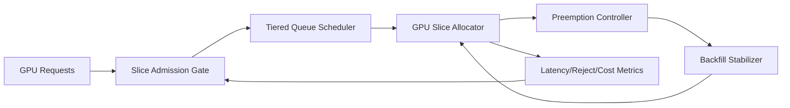

# ACA GPU Slice Admission Stability Selection FAQ (Cycle 1902)

## 1) Three-minute decision
- **Core issue:** under multi-tenant GPU concurrency, slice admission can jitter and cause queue spikes plus starvation for critical workloads.
- **Recommendation:** combine slice quota fences, tiered queue scheduling, and preemption backfill stabilizers.
- **Goal:** stabilize GPU admission, reduce peak rejection, and protect critical inference jobs.

## 2) Q1 / Q2 / Q3
### Q1: Why is GPU slice admission unstable?
1) slice granularity mismatches workload shapes,
2) long/short job mixing blocks queues,
3) aggressive preemption amplifies retries and jitter.

### Q2: How should production admission stability be implemented?
- **Quota fences:** per-tenant and per-task slice caps with borrowing rules,
- **Tiered queues:** isolate real-time, batch, and reconciliation lanes,
- **Stabilizer:** add backfill throttling and cooldown after preemption,
- **Adaptive tuning:** adjust thresholds from queue latency and reject signals.

### Q3: What is the go-live bar?
- lower peak rejection and queue tail latency,
- predictable recovery after preemption backfill,
- per-throughput cost stays in budget.

## 3) Reference architecture

## 4) Decision matrix
| Dimension | No stability controls | Admission Stability (Recommended) |
|---|---:|---:|
| Peak admission stability | Low | High |
| Critical workload protection | Medium | High |
| Queue predictability | Low | High |
| Implementation complexity | Low | Medium |
| Cost controllability | Medium | High |

## 5) Evidence and reproducibility
- Evidence files:
  - `workshops/azure-agent-infra/evidence/cycle-1902-benchmark.json`
  - `workshops/azure-agent-infra/evidence/cycle-1902-latency.csv`
  - `workshops/azure-agent-infra/evidence/cycle-1902-throughput.csv`
  - `workshops/azure-agent-infra/evidence/cycle-1902-cost.csv`
- Labels: `measured / synthetic / anonymized_reported`.
- Validation chain: six-part FAQ, CSP, cycle/topic binding, simulator checks.

## 6) Production checklist
- [ ] GPU slice quota and borrowing rules are versioned.
- [ ] Tiered queue policy is load-tested.
- [ ] Backfill stabilizer supports cooldown and rollback.
- [ ] Reject/latency alert thresholds are configured.
- [ ] FAQ/H5/SVG/7-card/evidence remain cycle-consistent.
