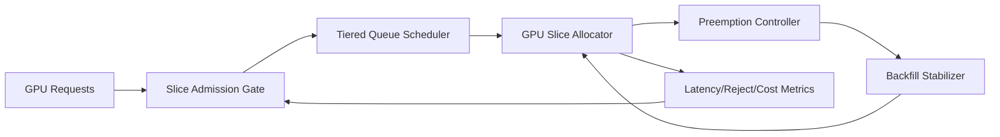

# ACA GPU Slice Admission Stability 选型 FAQ（Cycle 1902）

## 1) 3 分钟结论
- **核心问题：** GPU 切片资源在多租户并发场景下容易出现 admission 抖动，导致排队暴涨与关键任务饥饿。
- **推荐方案：** “切片配额护栏 + 队列分层调度 + 抢占回填稳定器”联合治理。
- **目标：** 保持 GPU 切片准入稳定，降低高峰拒绝率并保障关键推理任务。

## 2) Q1 / Q2 / Q3
### Q1：为什么 GPU slice admission 容易不稳定？
1) 切片粒度与请求画像不匹配会产生碎片；
2) 长短任务混排导致队列阻塞；
3) 抢占策略不当会放大抖动与重试。

### Q2：生产级 admission stability 如何落地？
- **配额护栏：** 按租户/任务类型设置切片上限与借用规则；
- **分层队列：** 关键实时、批处理、回补三层队列隔离；
- **稳定器：** 抢占后启用回填节流与冷却窗口；
- **动态校准：** 根据队列时延与拒绝率调整准入阈值。

### Q3：上线判据是什么？
- 高峰窗口拒绝率和队列尾延迟双下降；
- 抢占回填后的恢复时间可预测；
- 单位吞吐成本维持预算区间。

## 3) 架构图

## 4) 选型矩阵
| 维度 | 无稳定治理 | Admission Stability（推荐） |
|---|---:|---:|
| 高峰准入稳定性 | 低 | 高 |
| 关键任务保障 | 中 | 高 |
| 队列可预测性 | 低 | 高 |
| 实施复杂度 | 低 | 中 |
| 成本可控性 | 中 | 高 |

## 5) 证据与复算口径
- 证据文件：
  - `workshops/azure-agent-infra/evidence/cycle-1902-benchmark.json`
  - `workshops/azure-agent-infra/evidence/cycle-1902-latency.csv`
  - `workshops/azure-agent-infra/evidence/cycle-1902-throughput.csv`
  - `workshops/azure-agent-infra/evidence/cycle-1902-cost.csv`
- 标签：`measured / synthetic / anonymized_reported`。
- 校验链：FAQ 六段、CSP、cycle/topic 绑定、模拟器检查。

## 6) 生产检查清单
- [ ] GPU 切片配额护栏与借用规则已版本化。
- [ ] 三层队列策略经压测验证。
- [ ] 抢占回填稳定器具备冷却与回滚开关。
- [ ] 准入拒绝与队列时延告警阈值已配置。
- [ ] FAQ/H5/SVG/7-card/evidence 轮次一致。
