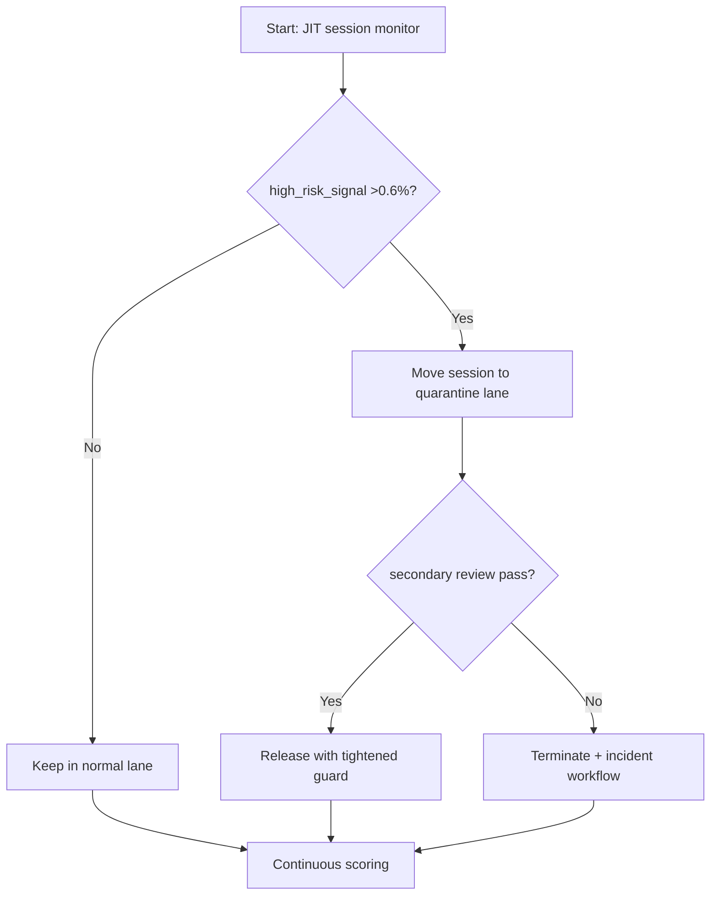
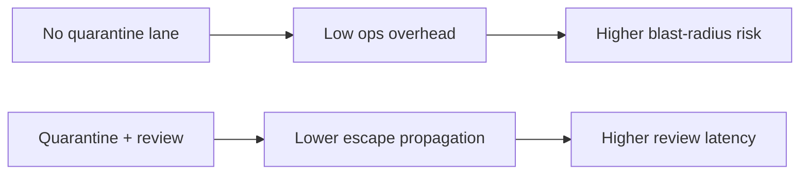
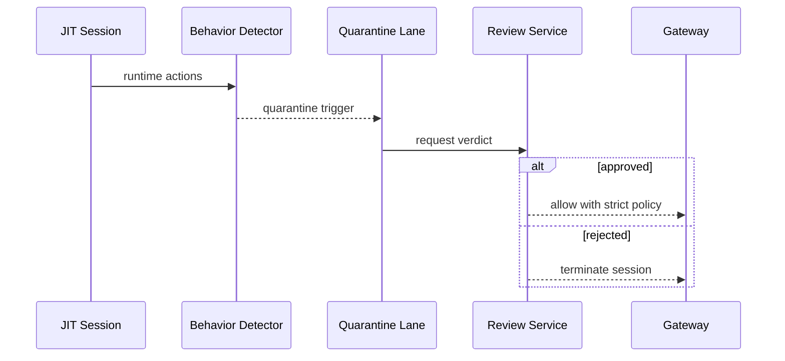

# Agent ACA JIT Session Quarantine Escape Guard Selection FAQ (Azure AI Agent Infra)

## 1) 3-minute conclusions
- **If high-risk syscall/behavior signals exceed 0.6% in JIT sessions, enforce quarantine lane with review-gated release.**
- **Static image allowlists are insufficient for escape prevention; add session-behavior guardrails.**
- **Targets: `escape_suspect_rate <0.1%`, `quarantine_decision_p95 <45s`, false-block rate <0.2%.**

## 2) Q1 / Q2 / Q3
- **Why are JIT sessions riskier?** Runtime instruction/tool combinations are less predictable.
- **Why isolate suspicious sessions?** Immediate separation prevents propagation to main execution lanes.
- **Minimum viable loop?** Behavior detection, quarantine execution, audit replay, dual review decisions.

### Q1: When is forced quarantine mandatory?
When high-risk rules match alongside anomalous network/file-access patterns.

### Q2: When is auto-release acceptable?
Low-risk rule hits with stable historical behavior and no correlated alerts.

### Q3: How to measure benefit?
Compare risk-event reduction against retry overhead from false blocks.

## 3) Mermaid diagrams
### 3.1 Decision tree

### 3.2 Path comparison

### 3.3 Sequence

## 4) Decision matrix
| Dimension | No quarantine lane | Quarantine + review (Recommended) |
|---|---:|---:|
| Suspect-session blast risk | Medium-high | Low |
| False-block control | Medium | Medium-high |
| Response speed | High | Medium |
| Ops complexity (1-10) | 4 | 8 |
| Compliance auditability | Medium | High |

## 5) Quant model + 7-card insights
- Risk rate: `RiskRate = SuspectSessions / TotalSessions`
- False-block cost: `FalseBlockCost = FalseBlocks * RetryCost`
- Example (`synthetic_assumed`):
  - `SuspectSessions=96, TotalSessions=120,000`
  - `RiskRate=0.08%`
  - `FalseBlocks=38/day, RetryCost=$0.21`
  - `FalseBlockCost=$7.98/day`
- Evidence:
  - `workshops/azure-agent-infra/evidence/cycle-1465-benchmark.json`
  - `workshops/azure-agent-infra/evidence/cycle-1465-sources.json`
- Labels: `official/synthetic_assumed/not_measured`.

## 6) Production verification checklist
- [ ] Quarantine-switch path for high-risk signals is validated
- [ ] Quarantine audit logs and replay trails are traceable
- [ ] Human-review SLA and auto-decision thresholds are defined
- [ ] False-block/release/incident-close metrics are monitored
- [ ] FAQ/7-card source labels are complete
