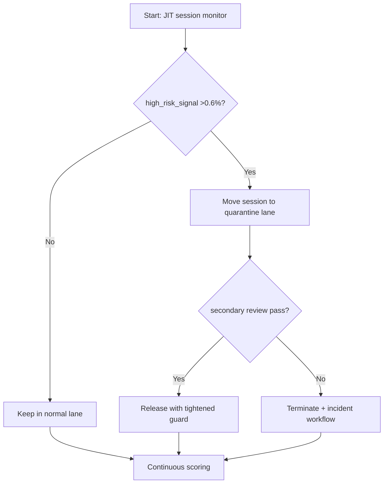
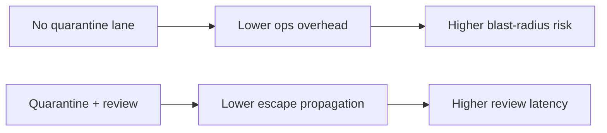
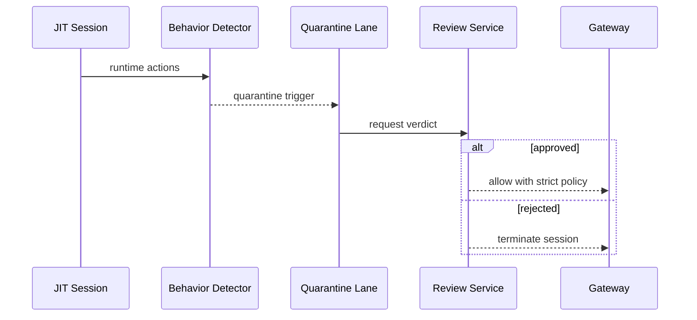

# Agent ACA JIT Session Quarantine Escape Guard 选型 FAQ（Azure AI Agent Infra）

## 1) 3 分钟结论
- **当 JIT 会话触发高危系统调用比例 >0.6% 时，必须启用“即时隔离（quarantine）+ 人工复核放行”。**
- **仅依赖静态镜像白名单不足以防逃逸，应叠加会话级行为门禁。**
- **生产阈值：`escape_suspect_rate <0.1%`、`quarantine_decision_p95 <45s`、误封率 <0.2%。**

## 2) Q1 / Q2 / Q3
- **为什么 JIT 会话风险更高？**：运行时指令与工具调用组合不可完全预编排。
- **为什么要隔离池？**：可疑会话应立即与主执行池解耦，防扩散。
- **最小闭环？**：行为检测、隔离执行、审计回放、人工/自动双判定。

### Q1：何时必须强制隔离？
当命中高危行为规则并伴随异常网络或文件访问序列。

### Q2：何时可自动放行？
低风险规则命中且历史行为一致、无关联告警。

### Q3：如何量化策略收益？
比较风险事件下降率与误封引起的重试开销。

## 3) Mermaid 图
### 3.1 决策树

### 3.2 路径对比

### 3.3 时序

## 4) 决策矩阵
| 维度 | 无隔离池 | 隔离池+复核（推荐） |
|---|---:|---:|
| 可疑会话扩散风险 | 中高 | 低 |
| 误封控制 | 中 | 中高 |
| 响应速度 | 高 | 中 |
| 运维复杂度（1-10） | 4 | 8 |
| 合规可审计性 | 中 | 高 |

## 5) 定量算例与 7-Card 洞察
- 风险率：`RiskRate = SuspectSessions / TotalSessions`
- 误封成本：`FalseBlockCost = FalseBlocks * RetryCost`
- 示例（`synthetic_assumed`）：
  - `SuspectSessions=96, TotalSessions=120,000`
  - `RiskRate=0.08%`
  - `FalseBlocks=38/day, RetryCost=$0.21`
  - `FalseBlockCost=$7.98/day`
- 证据：
  - `workshops/azure-agent-infra/evidence/cycle-1465-benchmark.json`
  - `workshops/azure-agent-infra/evidence/cycle-1465-sources.json`
- 标签：`official/synthetic_assumed/not_measured`。

## 6) 生产核验 Checklist
- [ ] 高危规则命中后隔离切换路径可验证
- [ ] 隔离池审计日志与回放可追溯
- [ ] 人工复核 SLA 与自动判定阈值已定义
- [ ] 误封率、放行率、事件关闭时长监控生效
- [ ] FAQ/7-Card 来源标签完整
