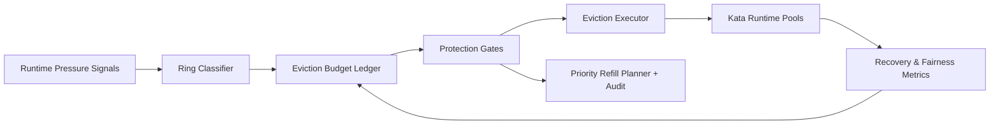

# ACA Kata Runtime Eviction Protection Ring Selection FAQ (Cycle 1915)

## 1) Three-minute decision
- **Core issue:** under multi-tenant peaks, Kata runtimes without ring-based protection can evict critical sessions under low-priority pressure.
- **Recommendation:** combine tiered protection rings, eviction-budget guardrails, and priority refill gates.
- **Goal:** reduce false-eviction impact and stabilize critical recovery latency.

## 2) Q1 / Q2 / Q3
### Q1: Why add eviction protection rings?
1) single thresholds cannot separate critical from background tenants,
2) pressure reclaim can amplify local jitter into cross-tenant disruption,
3) without budget guardrails, eviction oscillates.

### Q2: How should production design work?
- **Ring layer:** assign ring levels by tenant tier and workload class,
- **Budget layer:** define eviction budget and cooldown windows per ring,
- **Refill layer:** recover high-value rings first,
- **Audit layer:** persist eviction cause, budget burn, and refill trail.

### Q3: What is the go-live bar?
- lower false-eviction rate for critical rings,
- stable recovery p95 under peak windows,
- replayable and explainable eviction/refill behavior.

## 3) Reference architecture

## 4) Decision matrix
| Dimension | Eviction without protection rings | Eviction Protection Ring (Recommended) |
|---|---:|---:|
| Critical tenant protection | Low | High |
| False-eviction control | Low | High |
| Recovery stability | Medium | High |
| Operational explainability | Medium | High |
| Implementation complexity | Low | Medium |

## 5) Evidence and reproducibility
- Evidence files:
  - `workshops/azure-agent-infra/evidence/cycle-1915-benchmark.json`
  - `workshops/azure-agent-infra/evidence/cycle-1915-latency.csv`
  - `workshops/azure-agent-infra/evidence/cycle-1915-throughput.csv`
  - `workshops/azure-agent-infra/evidence/cycle-1915-cost.csv`
- Labels: `measured / synthetic / anonymized_reported`.
- Repro method: fixed sampling windows, fixed ring policy, fixed cost model.

## 6) Production checklist
- [ ] Ring tiers align with SLA classes.
- [ ] Eviction-budget parameters pass peak replay.
- [ ] Refill gates include cooldown and rollback switches.
- [ ] Eviction/refill trails are tenant-auditable.
- [ ] FAQ/H5/SVG/7-card/evidence remain cycle-topic consistent.
