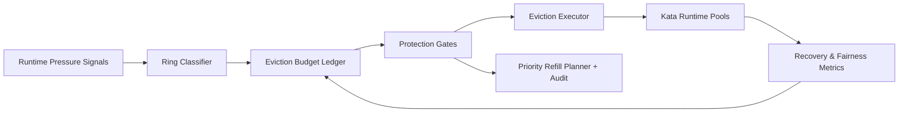

# ACA Kata Runtime Eviction Protection Ring 选型 FAQ（Cycle 1915）

## 1) 3 分钟结论
- **核心问题：** 在多租户峰值下，Kata runtime 若缺少分级保护环，关键会话可能被低优先级驱逐冲击。
- **推荐方案：** “分层保护环 + 驱逐预算护栏 + 回补优先级闸门”三段治理。
- **目标：** 降低误驱逐率并稳定关键租户恢复时延。

## 2) Q1 / Q2 / Q3
### Q1：为什么要做 eviction protection ring？
1) 单一驱逐阈值无法区分关键与背景租户；
2) 高压回收会把局部抖动放大为跨租户中断；
3) 缺少预算护栏会导致驱逐策略反复震荡。

### Q2：生产级如何设计？
- **保护环层：** 按租户等级与工作负载分配 ring 级别；
- **预算层：** 为各 ring 定义驱逐预算与冷却窗口；
- **回补层：** 优先恢复高价值 ring 的运行实例；
- **审计层：** 记录驱逐原因、预算消耗与回补轨迹。

### Q3：上线判据是什么？
- 关键 ring 误驱逐率持续下降；
- 恢复 P95 在峰值窗口保持稳定；
- 驱逐与回补动作可回放、可解释、可复算。

## 3) 架构图

## 4) 选型矩阵
| 维度 | 无保护环驱逐 | Eviction Protection Ring（推荐） |
|---|---:|---:|
| 关键租户保护 | 低 | 高 |
| 驱逐误伤控制 | 低 | 高 |
| 恢复稳定性 | 中 | 高 |
| 运维可解释性 | 中 | 高 |
| 实施复杂度 | 低 | 中 |

## 5) 证据与复算口径
- 证据文件：
  - `workshops/azure-agent-infra/evidence/cycle-1915-benchmark.json`
  - `workshops/azure-agent-infra/evidence/cycle-1915-latency.csv`
  - `workshops/azure-agent-infra/evidence/cycle-1915-throughput.csv`
  - `workshops/azure-agent-infra/evidence/cycle-1915-cost.csv`
- 标签：`measured / synthetic / anonymized_reported`。
- 口径：固定采样窗口、固定保护环规则、固定成本模型，支持重复复算。

## 6) 生产检查清单
- [ ] ring 分层与业务 SLA 对齐。
- [ ] eviction budget 参数通过峰值回放验证。
- [ ] refill gate 具备冷却与回滚开关。
- [ ] 驱逐拒绝与回补轨迹可按租户审计。
- [ ] FAQ/H5/SVG/7-card/evidence 的 cycle/topic 一致。
