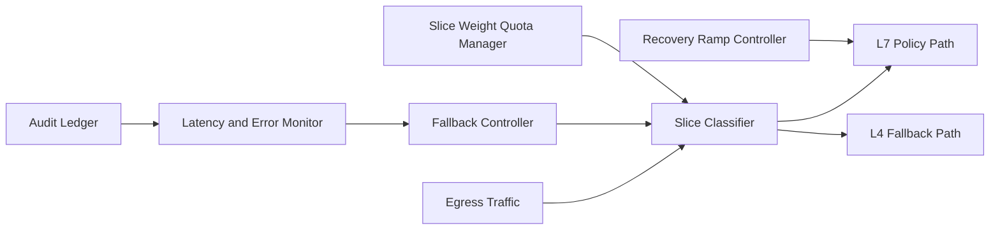

# ACA L4/L7 Egress Fallback Slicing Selection FAQ (Cycle 1886)

## 1) Three-minute decision
- **Core issue:** when L7 egress policy overloads, full rollback to one path makes critical and background traffic compete for the same capacity.
- **Recommendation:** combine layered L4/L7 fallback, traffic slicing, and weighted quota convergence.
- **Goal:** preserve critical continuity during policy-degrade windows while containing tail-latency spread.

## 2) Q1 / Q2 / Q3
### Q1: Why is "fallback all traffic to L4" unsafe?
1) critical and non-critical traffic lose isolation,
2) L4 congestion amplifies retry storms,
3) there is no smooth re-entry path to L7.

### Q2: How should production fallback slicing be designed?
- **Layered fallback:** only selected slices move to L4 on L7 anomalies,
- **Traffic slicing:** allocate slices by business priority and tenant tier,
- **Weighted quotas:** dynamically enforce slice occupancy weights,
- **Smooth recovery:** migrate slices back to L7 progressively with error-window checks.

### Q3: What is the go-live bar?
- critical-slice success remains within target during fallback,
- fallback-window P95/P99 latency stays bounded,
- re-entry causes no major jitter or error spikes.

## 3) Reference architecture

## 4) Decision matrix
| Dimension | Full fallback to L4 | Layered sliced fallback (Recommended) |
|---|---:|---:|
| Critical-flow protection | Low | High |
| Fallback-window stability | Medium | High |
| Recovery smoothness | Low | High |
| Implementation complexity | Low | Medium |
| Observability/tuning | Medium | High |

## 5) Evidence and reproducibility
- Evidence files:
  - `workshops/azure-agent-infra/evidence/cycle-1886-benchmark.json`
  - `workshops/azure-agent-infra/evidence/cycle-1886-latency.csv`
  - `workshops/azure-agent-infra/evidence/cycle-1886-throughput.csv`
  - `workshops/azure-agent-infra/evidence/cycle-1886-policy.csv`
- Labels: `measured / synthetic / anonymized_reported`.
- validation7 enforces six-part structure, CSP-safe 7-card output, strict cycle-topic alignment, and replayable checks.

## 6) Production checklist
- [ ] L4/L7 fallback boundaries and slice rules are configured.
- [ ] Weighted quotas converge under peak load tests.
- [ ] L7 recovery migration drills pass.
- [ ] Fallback/re-entry alerting is integrated.
- [ ] FAQ/H5/SVG/7-card/evidence remain cycle-consistent.
