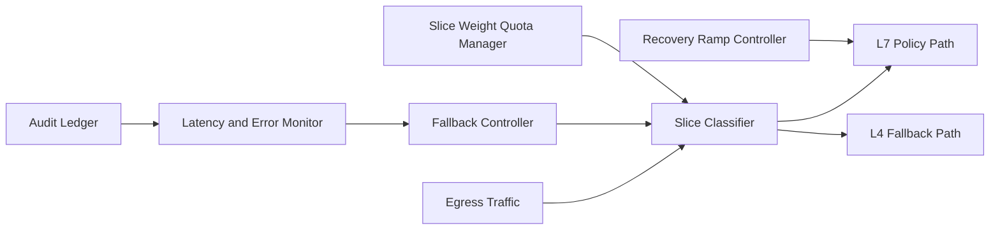

# ACA L4/L7 Egress Fallback Slicing 选型 FAQ（Cycle 1886）

## 1) 3 分钟结论
- **核心问题：** 出站链路在 L7 策略过载时若整体回退到单一路径，会导致关键流量与背景流量争抢同一出口容量。
- **推荐方案：** “L4/L7 分层回退 + 流量切片（slicing）+ 权重配额收敛”机制。
- **目标：** 在策略降级窗口内保障关键业务连续性并控制尾部时延扩散。

## 2) Q1 / Q2 / Q3
### Q1：为什么‘全量回退到 L4’不是稳妥方案？
1) 关键与非关键流量失去隔离；
2) L4 链路突发拥塞会放大重试风暴；
3) 回升到 L7 时缺少平滑切回路径。

### Q2：生产级 fallback slicing 应如何设计？
- **分层回退：** L7 异常时仅将指定流量片段回退到 L4；
- **流量切片：** 按业务优先级与租户等级划分切片配额；
- **权重配额：** 动态权重控制各切片占用比例；
- **平滑回升：** L7 恢复后逐段迁回并监控误差窗口。

### Q3：上线判据是什么？
- 关键切片成功率在回退期持续达标；
- 回退窗口 P95/P99 时延可控；
- 切回过程无明显抖动与错误激增。

## 3) 架构图

## 4) 选型矩阵
| 维度 | 全量回退 L4 | 分层切片回退（推荐） |
|---|---:|---:|
| 关键流量保障 | 低 | 高 |
| 回退期稳定性 | 中 | 高 |
| 切回平滑性 | 低 | 高 |
| 实施复杂度 | 低 | 中 |
| 可观测与调优 | 中 | 高 |

## 5) 证据与复算口径
- 证据文件：
  - `workshops/azure-agent-infra/evidence/cycle-1886-benchmark.json`
  - `workshops/azure-agent-infra/evidence/cycle-1886-latency.csv`
  - `workshops/azure-agent-infra/evidence/cycle-1886-throughput.csv`
  - `workshops/azure-agent-infra/evidence/cycle-1886-policy.csv`
- 标签：`measured / synthetic / anonymized_reported`。
- validation7：六段结构、7-card CSP、cycle-topic 对齐、验证链可回放。

## 6) 生产检查清单
- [ ] L4/L7 回退边界与切片规则配置完成。
- [ ] 权重配额在峰值压测下可自动收敛。
- [ ] L7 恢复迁回策略演练通过。
- [ ] 回退/切回阶段指标告警联调通过。
- [ ] FAQ/H5/SVG/7-card/evidence 轮次一致。
