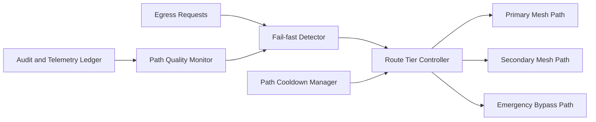

# ACA Mesh Egress Fail-fast Routing Selection FAQ (Cycle 1884)

## 1) Three-minute decision
- **Core issue:** when mesh egress degrades, retrying slow paths can turn local faults into system-wide tail latency.
- **Recommendation:** combine fail-fast detection, tiered egress candidates, and rapid bypass switching.
- **Goal:** minimize fault-detection and route-switch time so slow failures do not drain critical traffic.

## 2) Q1 / Q2 / Q3
### Q1: Why are retries and timeouts alone insufficient?
1) slow failures consume connection/thread budgets,
2) retry amplification increases downstream congestion,
3) critical requests lack explicit priority lanes during faults.

### Q2: How should production fail-fast routing be designed?
- **Fast detection:** trigger by error signatures, handshake latency, and packet loss,
- **Tiered routing:** switch across primary, secondary, and emergency bypass paths,
- **Cooldown windows:** hold unhealthy paths to prevent route flapping,
- **Feedback loop:** adapt thresholds using path-quality scoring.

### Q3: What is the go-live bar?
- converged P95/P99 latency in fault windows,
- stable critical-request success rate,
- switch count and flap rate within thresholds.

## 3) Reference architecture

## 4) Decision matrix
| Dimension | Timeout-retry dominant | Fail-fast tiered routing (Recommended) |
|---|---:|---:|
| Fault convergence speed | Low | High |
| Tail-latency stability | Low | High |
| Critical-path protection | Medium | High |
| Implementation complexity | Low | Medium |
| Routing observability | Medium | High |

## 5) Evidence and reproducibility
- Evidence files:
  - `workshops/azure-agent-infra/evidence/cycle-1884-benchmark.json`
  - `workshops/azure-agent-infra/evidence/cycle-1884-latency.csv`
  - `workshops/azure-agent-infra/evidence/cycle-1884-throughput.csv`
  - `workshops/azure-agent-infra/evidence/cycle-1884-policy.csv`
- Labels: `measured / synthetic / anonymized_reported`.
- validation7 enforces six-part structure, CSP-safe 7-card output, strict cycle-topic alignment, and replayable checks.

## 6) Production checklist
- [ ] Fail-fast trigger thresholds are calibrated.
- [ ] Primary/secondary/bypass switching policy is integrated.
- [ ] Cooldown anti-flap behavior passes stress tests.
- [ ] Path-quality feedback tuning is operational.
- [ ] FAQ/H5/SVG/7-card/evidence remain cycle-consistent.
