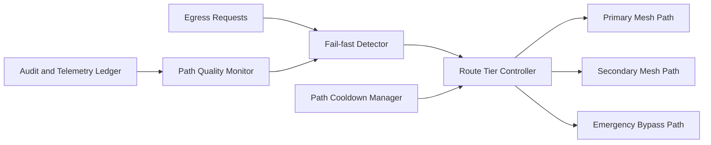

# ACA Mesh Egress Fail-fast Routing 选型 FAQ（Cycle 1884）

## 1) 3 分钟结论
- **核心问题：** Mesh 出站路径在局部故障时若继续重试慢路径，会把故障扩散为全链路尾延迟。
- **推荐方案：** “Fail-fast 判定 + 出站候选分层 + 快速旁路切换”组合。
- **目标：** 缩短故障检测与路由切换时间，避免慢失败拖垮关键流量。

## 2) Q1 / Q2 / Q3
### Q1：为什么只靠重试与超时会失效？
1) 慢失败会占满连接池与线程预算；
2) 重试叠加会放大下游拥塞；
3) 故障窗口内关键请求缺乏优先通道。

### Q2：生产级 fail-fast routing 如何设计？
- **快速判定：** 基于错误码、握手时延和丢包率触发 fail-fast；
- **路径分层：** 主路径、备用路径、应急旁路按优先级切换；
- **冷却窗口：** 故障路径进入冷却避免抖动反复切回；
- **观测闭环：** 按路径质量分动态调整阈值与切换策略。

### Q3：上线判据是什么？
- 故障窗口内 P95/P99 时延明显收敛；
- 关键请求成功率保持稳定；
- 切换次数与抖动率在阈值内。

## 3) 架构图

## 4) 选型矩阵
| 维度 | 超时重试主导 | Fail-fast 分层路由（推荐） |
|---|---:|---:|
| 故障收敛速度 | 低 | 高 |
| 尾延迟稳定性 | 低 | 高 |
| 关键流量保障 | 中 | 高 |
| 实施复杂度 | 低 | 中 |
| 路由可观测性 | 中 | 高 |

## 5) 证据与复算口径
- 证据文件：
  - `workshops/azure-agent-infra/evidence/cycle-1884-benchmark.json`
  - `workshops/azure-agent-infra/evidence/cycle-1884-latency.csv`
  - `workshops/azure-agent-infra/evidence/cycle-1884-throughput.csv`
  - `workshops/azure-agent-infra/evidence/cycle-1884-policy.csv`
- 标签：`measured / synthetic / anonymized_reported`。
- validation7：六段结构、7-card CSP、cycle-topic 对齐、验证链可回放。

## 6) 生产检查清单
- [ ] fail-fast 触发条件与阈值校准完成。
- [ ] 主/备/旁路分层切换策略联调通过。
- [ ] 冷却窗口抖动抑制压测通过。
- [ ] 路径质量反馈调参策略可执行。
- [ ] FAQ/H5/SVG/7-card/evidence 轮次一致。
