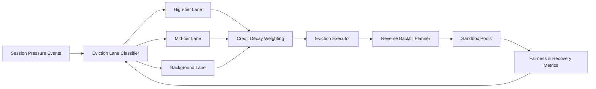

# ACA Multitenant Sandbox Eviction Lane Selection FAQ (Cycle 1908)

## 1) Three-minute decision
- **Core issue:** under capacity pressure, a single eviction queue in multi-tenant sandboxes treats critical and low-value workloads equally.
- **Recommendation:** use tenant-tiered eviction lanes, credit-decay weighting, and reverse-priority backfill.
- **Goal:** preserve critical continuity while maintaining fair eviction under constrained capacity.

## 2) Q1 / Q2 / Q3
### Q1: Why use eviction lanes instead of one global queue?
1) one queue cannot encode business value or compliance priority,
2) burst congestion lets low-value tasks crowd reclaim windows,
3) unlayered eviction increases tenant contention and cost drift.

### Q2: How should production eviction lanes be designed?
- **Tiered lanes:** separate eviction channels by tenant tier and workload type,
- **Credit weights:** apply tenant credit decay to prevent long-term occupation,
- **Reverse backfill:** prioritize recovery for critical lanes hit by over-eviction,
- **Adaptive tuning:** tune thresholds from false-eviction and recovery-latency signals.

### Q3: What is the go-live bar?
- lower interruption rates for critical tenants,
- stable cross-lane fairness metrics,
- bounded backfill cost and recovery latency.

## 3) Reference architecture

## 4) Decision matrix
| Dimension | Single eviction queue | Eviction Lane Governance (Recommended) |
|---|---:|---:|
| Critical workload protection | Low | High |
| Cross-tenant fairness | Medium | High |
| Recovery predictability | Low | High |
| Implementation complexity | Low | Medium |
| Operational explainability | Medium | High |

## 5) Evidence and reproducibility
- Evidence files:
  - `workshops/azure-agent-infra/evidence/cycle-1908-benchmark.json`
  - `workshops/azure-agent-infra/evidence/cycle-1908-latency.csv`
  - `workshops/azure-agent-infra/evidence/cycle-1908-throughput.csv`
  - `workshops/azure-agent-infra/evidence/cycle-1908-cost.csv`
- Labels: `measured / synthetic / anonymized_reported`.
- Validation chain: six-part FAQ, CSP, cycle/topic binding, simulator checks.

## 6) Production checklist
- [ ] Lane-tier rules align with tenant labels.
- [ ] Credit-decay weighting passes replay validation.
- [ ] Reverse-backfill scheduling has cooldown and rollback switches.
- [ ] False-eviction and recovery-latency metrics are alertable.
- [ ] FAQ/H5/SVG/7-card/evidence remain cycle-consistent.
