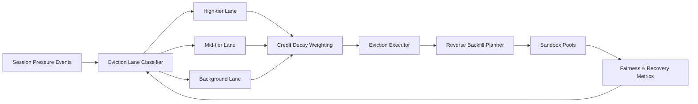

# ACA Multitenant Sandbox Eviction Lane 选型 FAQ（Cycle 1908）

## 1) 3 分钟结论
- **核心问题：** 多租户 sandbox 在资源紧缩时，如果 eviction 仅靠统一队列，会导致高价值租户与低价值任务同权驱逐。
- **推荐方案：** “租户分级驱逐车道 + 信用衰减权重 + 回补优先级反向调度”三层机制。
- **目标：** 在容量紧张窗口实现公平驱逐与关键业务连续性共存。

## 2) Q1 / Q2 / Q3
### Q1：为什么需要 eviction lane 而不是单一驱逐队列？
1) 单队列无法区分业务价值与合规等级；
2) 突发拥塞时低价值任务可能挤占关键回收窗口；
3) 驱逐不分层会放大跨租户争议和成本漂移。

### Q2：生产级 eviction lane 如何设计？
- **分级车道：** 按租户级别与任务类型分离驱逐通道；
- **信用权重：** 引入租户信用衰减，避免长期占用；
- **反向调度：** 回补时优先恢复被误伤的关键车道；
- **策略校准：** 按驱逐误伤率与恢复时延调整阈值。

### Q3：上线判据是什么？
- 关键租户会话中断率显著下降；
- 车道间驱逐公平性指标稳定；
- 回补成本与恢复时延维持预算目标。

## 3) 架构图

## 4) 选型矩阵
| 维度 | 单一驱逐队列 | Eviction Lane Governance（推荐） |
|---|---:|---:|
| 关键业务保护 | 低 | 高 |
| 跨租户公平性 | 中 | 高 |
| 恢复可预测性 | 低 | 高 |
| 实施复杂度 | 低 | 中 |
| 运维解释性 | 中 | 高 |

## 5) 证据与复算口径
- 证据文件：
  - `workshops/azure-agent-infra/evidence/cycle-1908-benchmark.json`
  - `workshops/azure-agent-infra/evidence/cycle-1908-latency.csv`
  - `workshops/azure-agent-infra/evidence/cycle-1908-throughput.csv`
  - `workshops/azure-agent-infra/evidence/cycle-1908-cost.csv`
- 标签：`measured / synthetic / anonymized_reported`。
- 校验链：FAQ 六段、CSP、cycle/topic 绑定、模拟器检查。

## 6) 生产检查清单
- [ ] 驱逐车道分级规则与租户标签对齐。
- [ ] 信用衰减权重模型经历史回放验证。
- [ ] 反向回补调度具备冷却与回滚开关。
- [ ] 误伤率与恢复时延看板具备告警。
- [ ] FAQ/H5/SVG/7-card/evidence 轮次一致。
