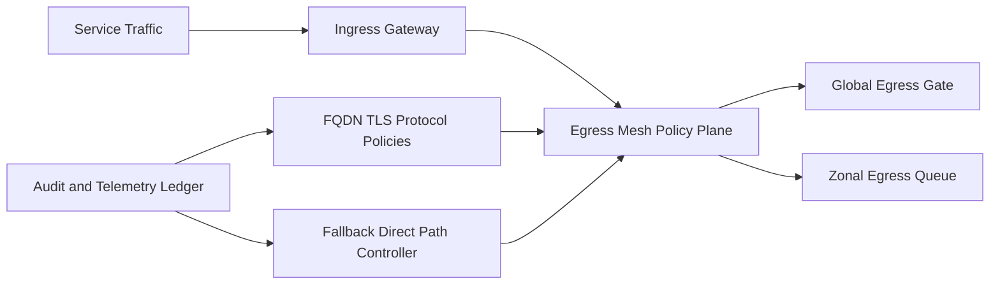

# ACA North-South Egress Mesh Selection FAQ (Cycle 1863)

## 1) Three-minute decision
- **Core tradeoff:** centralized north-south egress control improves governance, but layered egress paths can add latency and recovery complexity.
- **Recommendation:** two-layer egress mesh (gateway layer + policy layer) with zonal isolation and controlled direct-path fallback.
- **Goal:** enforce zero-trust egress while preserving stable throughput and recoverable low-latency paths.

## 2) Q1 / Q2 / Q3
### Q1: Why is per-service direct egress unsustainable?
1) fragmented policy enforcement weakens auditability,
2) repeated egress logic across services increases ops burden,
3) there is no centralized degradation control on egress failures.

### Q2: What production-grade north-south egress mesh should be used?
- **Two-layer model:** separate ingress/egress responsibilities with unified control points,
- **Unified policy:** centralized FQDN, certificate, and protocol allowlists,
- **Partition isolation:** isolate egress queues/rates by tenant or domain,
- **Failure fallback:** controlled fallback to minimal direct path on mesh anomalies.

### Q3: How do we validate effectiveness?
- higher block rate for policy-violating egress,
- acceptable P95 latency and availability on egress paths,
- bounded recovery time for mesh failures.

## 3) Reference architecture

## 4) Decision matrix
| Dimension | Decentralized direct egress | Two-layer egress mesh (Recommended) |
|---|---:|---:|
| Policy consistency | Low | High |
| Security governance | Low | High |
| Latency controllability | Medium | Medium-high |
| Implementation complexity | Low | Medium |
| Recovery capability | Low | High |

## 5) Evidence and reproducibility
- Evidence files:
  - `workshops/azure-agent-infra/evidence/cycle-1863-benchmark.json`
  - `workshops/azure-agent-infra/evidence/cycle-1863-latency.csv`
  - `workshops/azure-agent-infra/evidence/cycle-1863-throughput.csv`
  - `workshops/azure-agent-infra/evidence/cycle-1863-policy.csv`
- Labels: `measured / synthetic / anonymized_reported`.
- validation7 enforces bilingual six-part structure, CSP self-contained 7-card output, strict cycle-evidence alignment, and replayability.

## 6) Production checklist
- [ ] Two-layer egress mesh boundaries are frozen.
- [ ] Policy distribution and certificate validation paths pass integration.
- [ ] Partitioned queues and rate limits pass load tests.
- [ ] Direct-path fallback drills pass.
- [ ] FAQ/H5/SVG/7-card align with cycle evidence.
