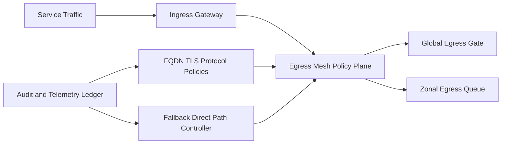

# ACA 南北向出口 Mesh 选型 FAQ（Cycle 1863）

## 1) 3 分钟结论
- **核心矛盾：** 南北向统一出口能增强策略治理，但出口链路层级增加会带来额外时延与可用性挑战。
- **推荐：** 双层出口 Mesh（应用网关层 + 出口策略层）+ 分区故障隔离 + 回退直连开关。
- **目标：** 在零信任出口控制下维持稳定吞吐和可恢复低延迟路径。

## 2) Q1 / Q2 / Q3
### Q1：为什么“每个服务各自直连出网”不可持续？
1) 策略分散，难以统一审计与追责；
2) 不同服务重复实现出口控制，运维负担高；
3) 出口异常时缺少集中降级机制。

### Q2：生产级南北向出口 Mesh 如何设计？
- **双层架构：** 入口/出口职责分离，统一策略点管控；
- **策略统一：** FQDN、证书、协议白名单集中下发；
- **分区隔离：** 按租户或业务域隔离出口队列与速率；
- **故障回退：** Mesh 异常时受控回退到最小直连路径。

### Q3：如何验证该方案有效？
- 出口违规请求拦截率提升；
- 出口路径 P95 时延与可用性达标；
- Mesh 故障恢复时间在可控窗口。

## 3) 架构图

## 4) 选型矩阵
| 维度 | 分散直连出网 | 双层出口 Mesh（推荐） |
|---|---:|---:|
| 策略一致性 | 低 | 高 |
| 安全治理 | 低 | 高 |
| 时延可控性 | 中 | 中高 |
| 实施复杂度 | 低 | 中 |
| 故障恢复能力 | 低 | 高 |

## 5) 证据与复算口径
- 证据文件：
  - `workshops/azure-agent-infra/evidence/cycle-1863-benchmark.json`
  - `workshops/azure-agent-infra/evidence/cycle-1863-latency.csv`
  - `workshops/azure-agent-infra/evidence/cycle-1863-throughput.csv`
  - `workshops/azure-agent-infra/evidence/cycle-1863-policy.csv`
- 标签：`measured / synthetic / anonymized_reported`。
- validation7：双语六段结构、7-card CSP 自包含、轮次与 evidence 一致、可回放链路通过。

## 6) 生产检查清单
- [ ] 双层出口 Mesh 路径与职责边界已固化。
- [ ] 策略下发与证书校验链路联调通过。
- [ ] 分区队列与速率限制压测达标。
- [ ] 故障回退直连开关演练通过。
- [ ] FAQ/H5/SVG/7-card 与 evidence 轮次一致。
