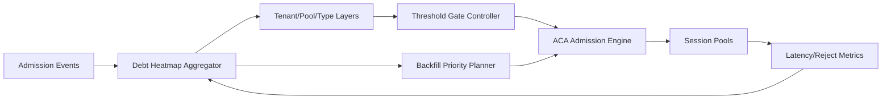

# ACA Sandbox Admission Debt Heatmap Selection FAQ (Cycle 1906)

## 1) Three-minute decision
- **Core issue:** admission debt silently accumulates across multi-tenant session pools; without heatmap visibility, reclaim/scheduling actions lag behind hotspots.
- **Recommendation:** use layered debt heatmaps, threshold-coupled admission control, and priority backfill orchestration.
- **Goal:** make debt distribution observable and schedulable to prevent hotspot amplification under peak load.

## 2) Q1 / Q2 / Q3
### Q1: Why is an admission-debt heatmap necessary?
1) debt accumulates across tenants and pools where single metrics miss hotspots,
2) missing hotspot ranking leads to incorrect reclaim/backfill order,
3) debt drift raises tail latency and rejection risk.

### Q2: How should production debt heatmaps be implemented?
- **Layered maps:** aggregate debt by tenant, pool, and session type,
- **Threshold coupling:** tighten admission when hotspot layers breach thresholds,
- **Priority backfill:** open cold zones first and reclaim hot zones first,
- **Policy tuning:** adapt gate parameters from heatmap slope signals.

### Q3: What is the go-live bar?
- hotspot debt peaks reduce and converge,
- queue tail latency and rejection rate decline together,
- no abnormal growth in backfill cost.

## 3) Reference architecture

## 4) Decision matrix
| Dimension | No debt heatmap | Debt Heatmap Governance (Recommended) |
|---|---:|---:|
| Hotspot detection speed | Low | High |
| Scheduling decision quality | Low | High |
| Peak stability | Medium | High |
| Implementation complexity | Low | Medium |
| Operational explainability | Medium | High |

## 5) Evidence and reproducibility
- Evidence files:
  - `workshops/azure-agent-infra/evidence/cycle-1906-benchmark.json`
  - `workshops/azure-agent-infra/evidence/cycle-1906-latency.csv`
  - `workshops/azure-agent-infra/evidence/cycle-1906-throughput.csv`
  - `workshops/azure-agent-infra/evidence/cycle-1906-cost.csv`
- Labels: `measured / synthetic / anonymized_reported`.
- Validation chain: six-part FAQ, CSP, cycle/topic binding, simulator checks.

## 6) Production checklist
- [ ] Heatmap layers align with tenant labels.
- [ ] Threshold-coupled gates are load-tested.
- [ ] Backfill priority policy includes rollback switch.
- [ ] Heatmap-slope alerts can trigger adaptive tuning.
- [ ] FAQ/H5/SVG/7-card/evidence remain cycle-consistent.
