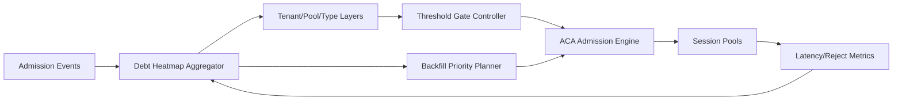

# ACA Sandbox Admission Debt Heatmap 选型 FAQ（Cycle 1906）

## 1) 3 分钟结论
- **核心问题：** admission debt 在多租户会话池中隐性累积，缺少热力图可视化会导致调度回收决策滞后。
- **推荐方案：** “债务热力图分层 + 阈值联动调度 + 回补优先级编排”三段式治理。
- **目标：** 让债务分布可见、可追踪、可调度，抑制高峰期的局部拥塞放大。

## 2) Q1 / Q2 / Q3
### Q1：为什么要做 admission debt heatmap？
1) 债务通常跨租户、跨节点累积，单点指标无法反映热点；
2) 无热区识别会导致回收与补位顺序错误；
3) 债务漂移会直接推高尾延迟与拒绝率。

### Q2：生产级 debt heatmap 如何落地？
- **分层热图：** 以租户、节点池、会话类型三维聚合债务；
- **阈值联动：** 热区超过阈值自动触发 admission 收紧；
- **优先级回补：** 冷区优先放量、热区优先回收；
- **策略校准：** 依据热图斜率动态调整门控参数。

### Q3：上线判据是什么？
- 热区债务峰值下降并稳定收敛；
- 队列尾延迟与拒绝率同步下降；
- 回补成本未出现异常增幅。

## 3) 架构图

## 4) 选型矩阵
| 维度 | 无债务热图 | Debt Heatmap Governance（推荐） |
|---|---:|---:|
| 热点识别速度 | 低 | 高 |
| 调度决策准确性 | 低 | 高 |
| 高峰稳定性 | 中 | 高 |
| 实施复杂度 | 低 | 中 |
| 运维可解释性 | 中 | 高 |

## 5) 证据与复算口径
- 证据文件：
  - `workshops/azure-agent-infra/evidence/cycle-1906-benchmark.json`
  - `workshops/azure-agent-infra/evidence/cycle-1906-latency.csv`
  - `workshops/azure-agent-infra/evidence/cycle-1906-throughput.csv`
  - `workshops/azure-agent-infra/evidence/cycle-1906-cost.csv`
- 标签：`measured / synthetic / anonymized_reported`。
- 校验链：FAQ 六段、CSP、cycle/topic 绑定、模拟器检查。

## 6) 生产检查清单
- [ ] 热力图分层维度与租户标签对齐。
- [ ] 阈值联动门控已通过压测演练。
- [ ] 回补优先级策略具备回滚开关。
- [ ] 热图斜率告警与自动调参联动可用。
- [ ] FAQ/H5/SVG/7-card/evidence 轮次一致。
