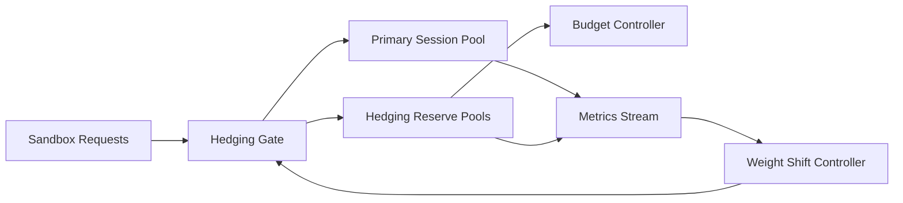

# ACA Sandbox Capacity Hedging Selection FAQ (Cycle 1891)

## 1) Three-minute decision
- **Core issue:** bursty sandbox traffic can saturate a single regional pool, amplifying cold starts and queue jitter.
- **Recommendation:** combine reserve hedging pools, budget gating, and weighted fallback rollback.
- **Goal:** sustain session availability and reduce tail latency under peak load.

## 2) Q1 / Q2 / Q3
### Q1: Why is capacity hedging needed?
1) burst traffic can exceed single-pool elasticity,
2) real-time scaling has cold-start and quota lag,
3) retries alone amplify queue delays.

### Q2: How should production capacity hedging be implemented?
- **Reserve pools:** keep warm cross-region/cross-size hedging capacity,
- **Budget gate:** dynamically cap hedging by cost budget,
- **Weight rollback:** shift traffic back smoothly when primary capacity recovers,
- **Observability loop:** track hit rates, rollback time, and excess spend.

### Q3: What is the go-live bar?
- lower session rejection rate during peaks,
- stable P95 tail latency within budget,
- explainable and controlled hedging cost.

## 3) Reference architecture

## 4) Decision matrix
| Dimension | No hedging strategy | Capacity Hedging (Recommended) |
|---|---:|---:|
| Peak availability | Medium | High |
| Tail-latency stability | Low | High |
| Cost controllability | Medium | High |
| Implementation complexity | Low | Medium |
| Operational observability | Medium | High |

## 5) Evidence and reproducibility
- Evidence files:
  - `workshops/azure-agent-infra/evidence/cycle-1891-benchmark.json`
  - `workshops/azure-agent-infra/evidence/cycle-1891-latency.csv`
  - `workshops/azure-agent-infra/evidence/cycle-1891-throughput.csv`
  - `workshops/azure-agent-infra/evidence/cycle-1891-cost.csv`
- Labels: `measured / synthetic / anonymized_reported`.
- Validation checks: six-part FAQ, CSP, cycle/topic binding, simulator checks.

## 6) Production checklist
- [ ] Hedging reserve limits and budget caps are defined.
- [ ] Weighted rollback policy is load-tested.
- [ ] Hedging hit rate and excess cost are traceable.
- [ ] Peak rejection rate and tail latency targets are met.
- [ ] FAQ/H5/SVG/7-card/evidence are cycle-consistent.
